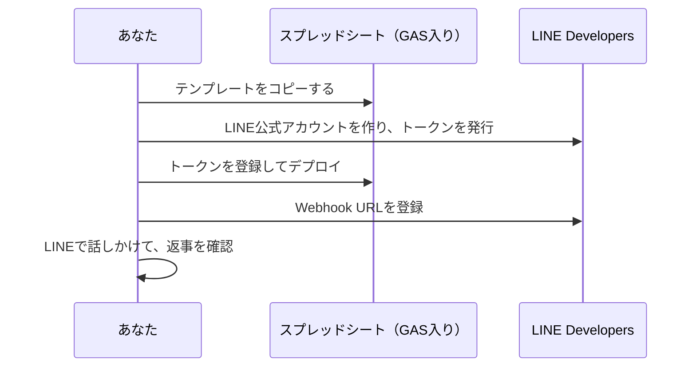

Step1 は Qiita の記事で進めます。LINE 公式アカウントを作るところから、GAS のデプロイ、Webhook の登録、おうむ返し Bot が動くところまでを1本にまとめてあります。GAS 入りのスプレッドシートをコピーして始めるので、コードは書きません。

👉 [GASで最速LINE Bot：コピーして15分でおうむ返し（受信JSONも見える）](https://qiita.com/4geru/items/5e5e23d6540beed4adc0)

記事が終わると、こうなっています。

- コピーしたスプレッドシートの GAS に、記事のコードが入っている
- LINE で話しかけると、送った言葉と、届いたメッセージの JSON が返ってくる
- スプレッドシートの `log` シートに、届いたイベントが1行ずつ残っている

Step2 では、この GAS に位置情報・状態管理・GPS検索を足していきます。記事のコードがそのまま土台です。記事の「次にやること」で `doPost` を書き換えた人は、記事のコードに戻してから進むと、この本の diff と見比べやすくなります。

:::message
次の「[LINE Messaging APIとは](./01-01-line-messaging-api)」は**読み物**です。記事の解説と重なるところもあるので、記事を読んだ人は軽く流して構いません。
:::

記事の Bot が返事をしてくれたら、Step2 に進みましょう。
