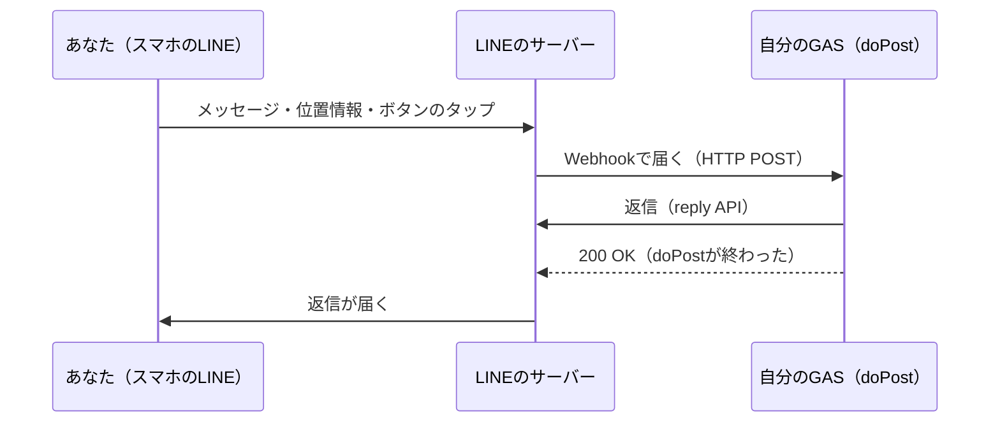

Step2 に入る前に、Bot の中で何が起きているかをざっくり押さえておきます。Step1 の記事を読んだ人は、軽く流して大丈夫です。

## Bot を書く = doPost の中身を書く

LINE で Bot に話しかけると、LINE のサーバーが、登録しておいた URL（GAS のウェブアプリ）に HTTP POST を送ってきます。これが Webhook です。

この本で書くのは、ほぼこの図の `doPost` の中身だけです。返信も `doPost` の中から LINE の API を呼んで送ります。

## 届くものは全部 `events` の1要素

テキストでも位置情報でも、ボタンのタップでも、届く JSON の形は同じです。`events` という配列の1要素として届くので、`type` を見て振り分けます。

LINE から届くイベントの種類はたくさんありますが、この本で使うのはごく一部です。

| 何が起きたか | 見分け方 |
| :--- | :--- |
| テキストが届いた | `event.message.type` が `text` |
| 位置情報が届いた | `event.message.type` が `location`（タイトル・住所・緯度経度が入っている） |
| 写真が届いた | `event.message.type` が `image`（もくもくの写真の章で使う） |
| ボタンが押された | `event.type` が `postback` |

上の3つは、どれも `event.type` が `message` のときに `event.message.type` で見分けます。

## 返信は replyToken で1回だけ

イベントには `replyToken` が付いてきます。これを reply API に渡すと、そのメッセージへの返信になります。使えるのは **1回だけ・約1分以内**です。何通か返したいときは、配列にまとめて1回で送ります（5通まで）。

この本の Bot は、全部 reply で返します。こちらから好きなときに送る push は使いません。

:::message
push は月に送れる数に上限があります（無料プランなら月200通）。reply は、この数に入りません。
:::

## クイックリプライと postback

「位置情報を送ってください」の下に出るボタンが、クイックリプライです。この本では2種類のボタンを使います。

- **location アクション**: 押すと、場所を選ぶ画面が開きます。届くのはふつうの `location` メッセージです
- **postback アクション**: 押すと、ボタンに仕込んでおいた文字列（`data`）が `postback` イベントで返ってきます

`data` には「何のボタンか」と「どの場所の話か（場所ID）」を書いておきます。「いま何問目を待っているか」は `data` には書かず、`state` シートにユーザー1人1行で覚えておいて、`userId` で引きます。詳しくは「[会話の「状態」を管理する](./02-02-state-management)」で。

クイックリプライのボタンは、次のメッセージがトークに流れると消えます。postback のボタンは、押したときにも消えます。

## 用語

| 用語 | この本での意味 |
| :--- | :--- |
| `webhookEventId` | イベント1件ごとに付く ID。この本では「メッセージID」と呼ぶ |
| `message.id` | メッセージに付く ID。`message` イベントにしか無い。写真を取りに行くときに使う |
| `replyToken` | 返信に使うトークン。1回だけ・約1分 |
| `state` | ユーザー1人につき1行のメモ。いま何を待っているか（何問目か）を覚えておく |
| 場所ID（`locationId`） | 1つの場所を指す ID。位置情報の `webhookEventId` を使う。ボタンの `data` に入れる |

`message.id` ではなく `webhookEventId` を「メッセージID」にしているのは、postback イベントには `message.id` が無いからです。`webhookEventId` ならどのイベントにも付いているので、`location` シートにも `postback` シートにも同じ種類の ID を残せます。

## 参考

- [Messaging APIリファレンス](https://developers.line.biz/ja/reference/messaging-api/)
- [Webhookの仕組み](https://developers.line.biz/ja/docs/messaging-api/receiving-messages/)
- [クイックリプライを使う](https://developers.line.biz/ja/docs/messaging-api/using-quick-reply/)
