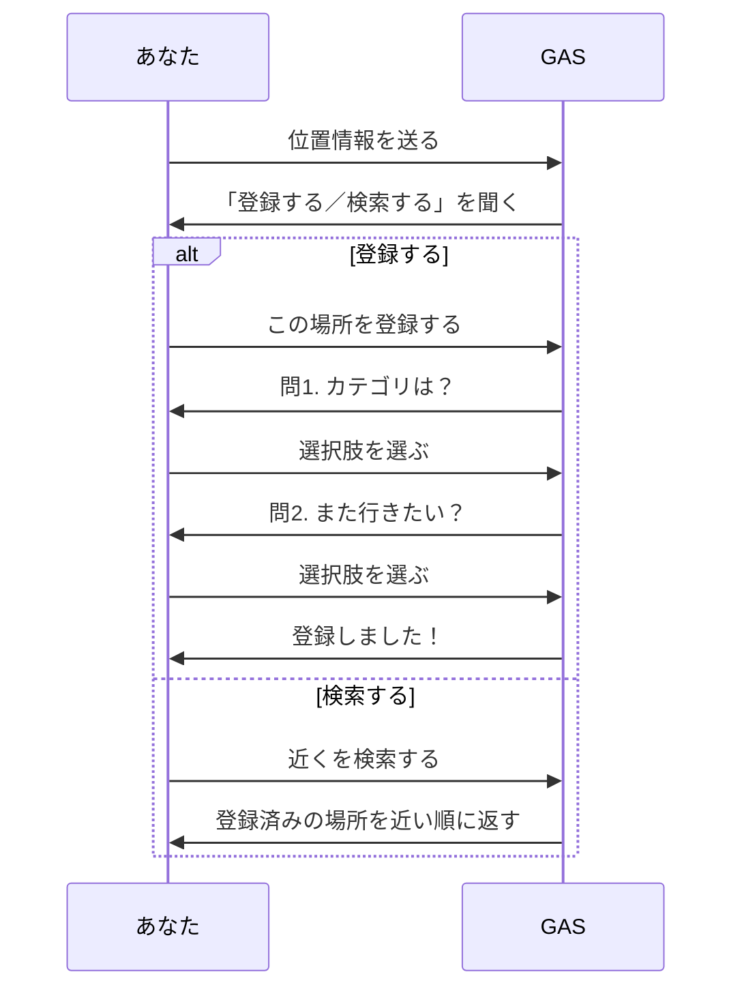

Step2 では、まちの記憶アーカイブBot の本体を作ります。ゴールは、次の会話ができるようになることです。

5つの章で、少しずつ組み立てます。

| 章 | やること |
| :--- | :--- |
| [位置情報を受け取る](./02-01-receive-location) | 位置情報を受け取って、シートに残す |
| [会話の「状態」を管理する](./02-02-state-management) | 「いま何を待っているか」を1人1行で覚える仕組みを作る |
| [位置から登録する](./02-03-register-from-location) | 状態管理を使って、質問に答えて登録する会話を作る |
| [質問をシートで増やす](./02-03b-question-sheet) | 質問をスプレッドシートに移し、登録を1行ずつの表（`submission`）で見る |
| [GPS検索を作る](./02-04-gps-search) | 登録した場所の中から、近い順に探す |

**「会話の「状態」を管理する」は少し理屈っぽい章**ですが、あとの章の土台なので飛ばさずに読んでください。5章とも終われば、まちの記憶アーカイブBot の必須パートは完成です。

:::message
時間が足りないときは、**「質問をシートで増やす」まで**終われば区切りになります。質問に答えて登録し、`submission` で確かめるところまでできます。検索は、あとから「GPS検索を作る」を足せば動きます。
:::
