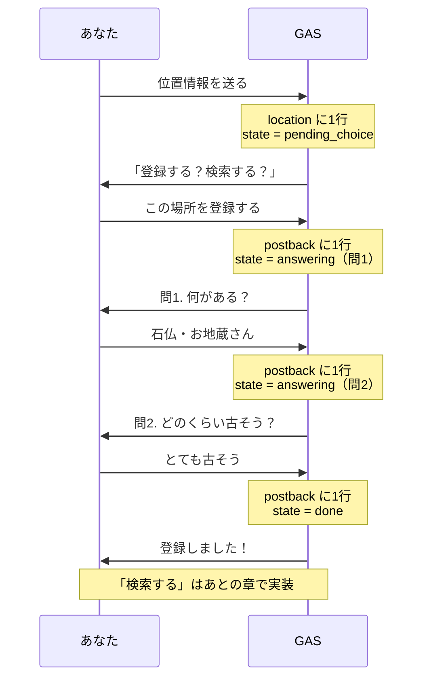

前の章で作った state を使って、「位置情報を送る → 登録するを選ぶ → 質問に2つ答える → 登録完了」の会話を作ります。「検索する」側は「GPS検索を作る」の章です。

## 全体の流れ



## doPost を振り分けるだけにする

分岐が増えてきたので、`doPost` は種類ごとに振り分けるだけにして、中身は別の関数に任せます。**`doPost` を丸ごと貼り替えます。**

```javascript:コード.gs
function doPost(e) {
  var body = JSON.parse(e.postData.contents);

  body.events.forEach(function (event) {
    saveLog(event);
    var userId = event.source ? event.source.userId : "";

    if (event.type === "message") {
      var msg = event.message;

      if (msg.type === "text") {
        handleTextMessage(event.replyToken, userId, msg.text);

      } else if (msg.type === "location") {
        var place = toPlace(event.webhookEventId, msg);
        saveLocation(userId, place);
        handleLocationMessage(event.replyToken, userId, place);
      }

    } else if (event.type === "postback") {
      var data = JSON.parse(event.postback.data);
      var displayText = event.postback.displayText || "";
      handlePostback(event.replyToken, userId, event.webhookEventId, data, displayText);
    }
  });
  // LINE の Webhook 検証で 302 にならないよう、何も返さない
}
```

`postback`（ボタンが押された）の分岐が増えました。押されたボタンを `postback` シートに残すのは、ここではなく `handlePostback` の中です。理由はボタンの処理のところで説明します。

## テキストと位置情報の処理

テキストへの返事は前の章と同じです。位置情報を受け取ったら、**その場で自分の state に場所をメモしてから**「登録する／検索する」のボタンを返します。

```javascript:コード.gs
function handleTextMessage(replyToken, userId, text) {
  replyTextWithQuickReply(replyToken, "登録・検索したい場所の位置情報を送ってください", buildLocationQuickReply());
}

function handleLocationMessage(replyToken, userId, place) {
  setState(userId, "pending_choice", place);

  var replyBody =
    "受け取った位置情報\n" +
    "タイトル: " + place.title + "\n" +
    "住所: " + place.address;
  replyTextWithQuickReply(replyToken, replyBody, buildChoiceQuickReply(place.locationId));
}
```

`payload` に緯度経度も入れておくので、あとで検索するときに `location` シートを探し直さずに済みます。

## 「登録する／検索する」のボタン

```javascript:コード.gs
function buildChoiceQuickReply(locationId) {
  var choices = [
    { label: "この場所を登録する", action: "register" },
    { label: "近くを検索する", action: "search" }
  ];
  return {
    items: choices.map(function (choice) {
      return {
        type: "action",
        action: {
          type: "postback",
          label: choice.label,
          data: JSON.stringify({ action: choice.action, locationId: locationId }),
          displayText: choice.label
        }
      };
    })
  };
}
```

ボタンの `data` には、**何のボタンか（`action`）とどの場所か（`locationId` = 場所ID）**を JSON 文字列で入れます。押されると、この文字列がそのまま `event.postback.data` で返ってきます。この本のボタンの `data` は、次の形にそろえます。

| ボタン | data |
| :--- | :--- |
| この場所を登録する | `{"action":"register","locationId":"…"}` |
| 近くを検索する | `{"action":"search","locationId":"…"}` |
| 質問の選択肢 | `{"action":"answer","locationId":"…","question":1,"choice":3}` |

何問目を待っているかは `data` ではなく state に書いてあります。`data` は「押されたボタンが何だったか」の控えです。

## 質問を送る

登録するときに聞く質問を用意します。新しいファイル `Question.gs` を作り（作り方は `State.gs` と同じです）、貼り付けます。

```javascript:Question.gs
function getQuestions() {
  return [
    { text: "何がある？", choices: ["石仏・お地蔵さん", "道標・石碑", "古い町家", "井戸・水路", "その他"] },
    { text: "どのくらい古そう？", choices: ["とても古そう", "少し古そう", "わからない"] }
  ];
}

function askQuestion(replyToken, locationId, n) {
  var question = getQuestions()[n - 1];
  if (!question) {
    replyText(replyToken, "質問が見つかりません。question シートを確かめてください（setupSheets を実行）。");
    return;
  }

  var items = [];
  question.choices.forEach(function (choice, i) {
    if (choice === "") return;
    items.push({
      type: "action",
      action: {
        type: "postback",
        label: choice.slice(0, 20),
        data: JSON.stringify({ action: "answer", locationId: locationId, question: n, choice: i + 1 }),
        displayText: choice
      }
    });
  });
  replyTextWithQuickReply(replyToken, "問" + n + ". " + question.text, { items: items });
}
```

`getQuestions` は、いまは決まった2問を返すだけです。次の章で、ここをスプレッドシートから読む形に差し替えます。「質問が見つかりません」の文に出てくる `question` シートと `setupSheets` も、次の章で作ります。この章のままなら、この返事は出ません。

`askQuestion` は問 n の質問文と、選択肢のボタンを送ります。ボタンの `data` には問番号（`question`）と、何番目の選択肢か（`choice`）を入れます。空の選択肢はボタンにしませんが、番号は詰めません。ボタンのラベルは20文字までしか表示できないので、`slice(0, 20)` で切ります。押したときにトークに出る文字（`displayText`）は全文のままです。

## ボタンが押されたときの処理

```javascript:コード.gs
function handlePostback(replyToken, userId, messageId, data, displayText) {
  var state = getState(userId);
  if (!isCurrentButton(state, data)) {
    replyText(replyToken, "もう一度位置情報を送ってください。");
    return;
  }

  // 受け付けたボタンだけを postback に残す（断ったボタンは log にだけ残る）
  savePostback(userId, messageId, data.locationId, JSON.stringify(data), displayText);

  if (data.action === "register") {
    var place = state.payload;
    place.question = 1;
    place.answers = {};
    setState(userId, "answering", place);
    askQuestion(replyToken, place.locationId, 1);
    return;
  }

  if (data.action === "answer") {
    var questions = getQuestions();
    var answering = state.payload;
    var question = questions[data.question - 1];
    answering.answers[data.question] = question ? question.choices[data.choice - 1] : "";

    if (data.question < questions.length) {
      answering.question = data.question + 1;
      setState(userId, "answering", answering);
      askQuestion(replyToken, answering.locationId, answering.question);
      return;
    }

    clearState(userId);
    var lines = questions.map(function (q, i) {
      return q.text + " " + (answering.answers[i + 1] || "");
    });
    replyText(replyToken, "登録しました！\n" + lines.join("\n"));
    return;
  }

  replyText(replyToken, "受け取ったpostbackデータ\n" + JSON.stringify(data, null, 2));
}

function isCurrentButton(state, data) {
  if (!state || state.payload.locationId !== data.locationId) return false;
  if (data.action === "answer") {
    return state.status === "answering" && state.payload.question === data.question;
  }
  return state.status === "pending_choice";
}

function savePostback(userId, messageId, locationId, data, displayText) {
  var sheet = getOrCreateSheet(SHEET_NAMES.POSTBACK);
  sheet.appendRow([new Date(), userId, messageId, locationId, data, displayText || ""]);
}
```

先頭で `getState(userId)` を呼び、自分の state を引きます。postback イベントには「何問目への答えか」は入っていません。state を見て、はじめて「この人は問1の答えを待っていた」と分かります。

`isCurrentButton` は、押されたボタンが**いま進んでいる会話のものか**を確かめます。場所IDが state と違う（前に送った場所のボタン）、問番号が違う（同じボタンの二度押し）、state が無い・30分たった、のどれかなら「もう一度位置情報を送ってください」と返して終わりです。

確かめてから `savePostback` で `postback` シートに残します。**断ったボタンは `postback` に保存しません**（押されたこと自体は `log` に残ります）。こうしておくと、`postback` には Bot が受け付けた回答だけが並び、Bot の「登録しました」とシートの中身が食い違いません。

最後の問に答えたら `clearState` で `done` にして、質問と回答を1行ずつ並べて返します。どの分岐にも当てはまらないときは、届いた `data` をそのまま返します。まだ作っていない「近くを検索する」を押すと、これが返ってきます。

再デプロイして、LINE で試します。

## ✅ 確認

1. 位置情報を送る
   → 「この場所を登録する／近くを検索する」のボタンが出る

   

2. 「この場所を登録する」を押す
   → 「問1. 何がある？」と選択肢のボタンが出る
3. 選択肢を選ぶ
   → 「問2. どのくらい古そう？」が出る
4. 選択肢を選ぶ
   → 「登録しました！」のあとに「何がある？ 石仏・お地蔵さん」のような行が2行返ってくる

   

`postback` シートに「登録する」の行（`"action":"register"`）が1つと、`"action":"answer"` の行が2つ（問1と問2）増え、`state` シートの自分の行の `status` が `done` になっていれば成功です。


`postback` シートの「表示テキスト」列は空のままです。LINE の postback イベントには、押したときにトークに出た文字（`displayText`）が入ってこないためで、故障ではありません。押したボタンの中身は「データ」列で分かります。

この時点では、登録は `postback` の行として残っているだけです。場所と回答を1行にまとめた表は、次の章で作ります。

## 🎖️ 早く終わった人へ

### 🎖️ 古いボタンを押してみる

:::details 試し方
登録が終わったあとで、さっきの問1の選択肢をもう一度押します。「もう一度位置情報を送ってください。」と返ってきて、`postback` シートの行が増えていなければ成功です。`log` シートには、押した記録が1行増えています。
:::

### 🎖️ 期限切れを体験する

30分待つのは長いので、期限を1分に縮めてみます。

:::details 答えを見る
```diff:State.gs
-var STATE_EXPIRES_MINUTES = 30;
+var STATE_EXPIRES_MINUTES = 1;
```

再デプロイして位置情報を送り、1分以上待ってから「この場所を登録する」を押します。「もう一度位置情報を送ってください。」と返ってきたら成功です。試したら 30 に戻しておきましょう。
:::
