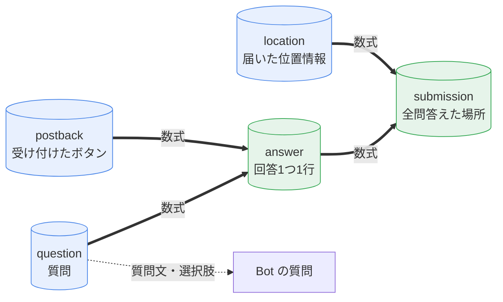

前の章では、質問をコードに書きました。この章では質問をスプレッドシートに移して、**行を足すだけで質問を増やせる**ようにします。あわせて、登録した場所と回答を1行ずつ並べた表（`submission`）を作ります。

## 3つのシート

この章で増えるシートは3つです。

| シート | 1行 = | 誰が書くか |
| :--- | :--- | :--- |
| `question` | 質問1つ（A列に質問、B〜F列に選択肢1〜5） | 最初はサンプル2問。あとは人が編集する |
| `answer` | 回答1つ（送信日時, 行番号, 場所ID, 問番号, 選択番号, 選んだ文字） | 数式 |
| `submission` | 登録1件（場所のID, タイトル, 住所, 緯度, 経度, 質問ごとの回答） | 数式 |



青のシートは Bot か人が書き、緑のシートは数式だけでできています。`answer` は `postback` の JSON から回答を読み取り、`question` を見て「選んだ文字」を引きます。`submission` は、`location` の場所のうち**今ある質問すべてに答えた場所だけ**を出します。登録の途中でやめた場所や、検索に使っただけの場所は出ません。

## シートの名前を足す

`コード.gs` の先頭の `SHEET_NAMES` に3つ足します。`HEADERS` には足しません。この3つのシートは、あとで書く `setupSheets` が作ります。

```diff:コード.gs
 var SHEET_NAMES = {
   LOCATION: "location",
   POSTBACK: "postback",
   LOG: "log",
-  STATE: "state"
+  STATE: "state",
+  QUESTION: "question",
+  ANSWER: "answer",
+  SUBMISSION: "submission"
 };
```

## 質問をシートから読む

`Question.gs` の `getQuestions` を**丸ごと貼り替えます**。あわせて、`question` シートの見出しとサンプルの2問を足します。

```javascript:Question.gs
var QUESTION_HEADERS = ["質問", "選択肢1", "選択肢2", "選択肢3", "選択肢4", "選択肢5"];

var SAMPLE_QUESTIONS = [
  ["何がある？", "石仏・お地蔵さん", "道標・石碑", "古い町家", "井戸・水路", "その他"],
  ["どのくらい古そう？", "とても古そう", "少し古そう", "わからない", "", ""]
];

function getQuestions() {
  var sheet = SpreadsheetApp.getActiveSpreadsheet().getSheetByName(SHEET_NAMES.QUESTION);
  if (!sheet || sheet.getLastRow() < 2) return [];

  var values = sheet.getRange(2, 1, sheet.getLastRow() - 1, 6).getValues();
  var questions = [];
  for (var i = 0; i < values.length; i++) {
    if (values[i][0] === "") break;
    questions.push({
      text: String(values[i][0]),
      choices: values[i].slice(1).map(function (v) { return String(v); })
    });
  }
  return questions;
}
```

返す形は前の章と同じ（`text` と `choices`）なので、`askQuestion` と `handlePostback` は変えません。A列が空の行まで来たら読むのをやめます。サンプルの2問は前の章の2問と同じ中身なので、前の章で答えた回答もそのまま使えます。

`askQuestion` は毎回 `getQuestions` を呼ぶので、`question` シートを編集すると、次に聞く質問からすぐ変わります。再デプロイは要りません。

## setupSheets を書く

`question` / `answer` / `submission` の3つのシートを作る関数です。`Question.gs` に続けて貼り付けます。

```javascript:Question.gs
function setupSheets() {
  getOrCreateSheet(SHEET_NAMES.LOCATION);
  getOrCreateSheet(SHEET_NAMES.POSTBACK);

  var ss = SpreadsheetApp.getActiveSpreadsheet();
  if (!ss.getSheetByName(SHEET_NAMES.QUESTION)) {
    var question = ss.insertSheet(SHEET_NAMES.QUESTION);
    question.appendRow(QUESTION_HEADERS);
    SAMPLE_QUESTIONS.forEach(function (row) { question.appendRow(row); });
    question.setFrozenRows(1);
  }

  var answer = ss.getSheetByName(SHEET_NAMES.ANSWER) || ss.insertSheet(SHEET_NAMES.ANSWER);
  answer.getRange("A1").setFormula(ANSWER_FORMULA);
  answer.getRange("H1").setFormula(ANSWER_ERROR_FORMULA);
  answer.getRange("A2:A").setNumberFormat("yyyy/mm/dd hh:mm");

  var submission = ss.getSheetByName(SHEET_NAMES.SUBMISSION) || ss.insertSheet(SHEET_NAMES.SUBMISSION);
  submission.getRange("A1").setFormula(SUBMISSION_FORMULA);

  console.log("question / answer / submission を準備しました");
}
```

`question` は、まだ無いときだけサンプルの2問で作ります。何度実行しても、自分で編集した質問は上書きしません。`answer` と `submission` は、A1（`answer` は H1 も）に数式を1つ入れるだけです。数式が下と右に結果を広げてくれます。`answer` の A 列（送信日時）は、数式の結果のままだと `46296.41667` のような数字で出るので、`setNumberFormat` で日時の表示にしています。

数式そのものは長いので畳んであります。開いて、3行まとめて `Question.gs` の一番下に貼り付けます。

:::details 数式（3つ）
```javascript:Question.gs
var ANSWER_FORMULA = '=ARRAYFORMULA(LET(d,FILTER(postback!A2:F,postback!A2:A<>""),n,SEQUENCE(ROWS(d)),js,CHOOSECOLS(d,5),act,IFERROR(REGEXEXTRACT(js,"""action""\\s*:\\s*""([^""]*)"""),""),loc,IFERROR(REGEXEXTRACT(js,"""locationId""\\s*:\\s*""([^""]*)"""),""),q,IFERROR(VALUE(REGEXEXTRACT(js,"""question""\\s*:\\s*(\\d+)")),0),c,IFERROR(VALUE(REGEXEXTRACT(js,"""choice""\\s*:\\s*(\\d+)")),0),txt,MAP(q,c,LAMBDA(x,y,IF(OR(x<1,y<1),"",IFERROR(INDEX(question!B2:F,x,y)&"","")))),ok,(act="answer")*(loc<>"")*(txt<>""),VSTACK({"送信日時","行番号","場所ID","問番号","選択番号","選んだ文字"},IFERROR(SORT(FILTER(HSTACK(CHOOSECOLS(d,1),n,loc,q,c,txt),ok=1),1,TRUE,2,TRUE),{"","","","","",""}))))';

var ANSWER_ERROR_FORMULA = '=ARRAYFORMULA(LET(d,FILTER(postback!A2:F,postback!A2:A<>""),js,CHOOSECOLS(d,5),act,IFERROR(REGEXEXTRACT(js,"""action""\\s*:\\s*""([^""]*)"""),""),loc,IFERROR(REGEXEXTRACT(js,"""locationId""\\s*:\\s*""([^""]*)"""),""),q,IFERROR(VALUE(REGEXEXTRACT(js,"""question""\\s*:\\s*(\\d+)")),0),c,IFERROR(VALUE(REGEXEXTRACT(js,"""choice""\\s*:\\s*(\\d+)")),0),txt,MAP(q,c,LAMBDA(x,y,IF(OR(x<1,y<1),"",IFERROR(INDEX(question!B2:F,x,y)&"","")))),VSTACK("読めなかった行（メッセージID）",IFERROR(FILTER(CHOOSECOLS(d,3),(act="answer")*(((loc="")+(txt=""))>0)),"なし"))))';

var SUBMISSION_FORMULA = '=ARRAYFORMULA(LET(qs,FILTER(question!A2:A,question!A2:A<>""),nq,ROWS(qs),aloc,FILTER(answer!C2:C,answer!C2:C<>""),aq,FILTER(answer!D2:D,answer!C2:C<>""),at,FILTER(answer!F2:F,answer!C2:C<>""),akey,aloc&"|"&aq,lr,FILTER(location!C2:G,location!C2:C<>"",ISNUMBER(MATCH(location!C2:C,aloc,0))),ids,CHOOSECOLS(lr,1),ans,MAKEARRAY(ROWS(ids),nq,LAMBDA(r,k,XLOOKUP(INDEX(ids,r)&"|"&k,akey,at,"無回答",0,-1))),full,HSTACK(lr,ans),done,BYROW(ans,LAMBDA(row,SUM(--(row="無回答"))=0)),IFNA(VSTACK(HSTACK({"場所のID","タイトル","住所","緯度","経度"},TRANSPOSE(qs)),IFERROR(FILTER(full,done),"（全問に答えた場所はまだありません）")),"")))';
```

- `ANSWER_FORMULA`（`answer!A1`）: `postback` のうち `action` が `answer` の行から、場所ID・問番号・選択番号を読み取り、`question` から選んだ文字を引いて、送信日時の順に並べます
- `ANSWER_ERROR_FORMULA`（`answer!H1`）: `action` が `answer` なのに読めなかった行のメッセージIDを出します。ふだんは「なし」です
- `SUBMISSION_FORMULA`（`submission!A1`）: `location` の場所ごとに各問の最新の回答を引き、全問そろった場所だけを出します
:::

## setupSheets を実行する

1. エディタ上部の関数プルダウンで **`setupSheets`** を選び、「実行」を押す
2. 実行ログに「question / answer / submission を準備しました」と出る
3. スプレッドシートに `question` / `answer` / `submission` の3つのシートができている


:::message alert
エディタを開いた直後は、関数プルダウンがしばらくグレーで選べません。その間に選ぶと、**表示だけ変わって、実際には前の関数（`doPost` など）が実行されます**。プルダウンが選べるようになってから選び、実行後は左メニューの「実行数」で関数名が `setupSheets` になっているか確かめてください。
:::


承認を求められたら、Step1 と同じ手順で許可します。承認の直後に「新しいデプロイ」のダイアログが出ることがありますが、ここでデプロイする必要はありません。閉じて構いません。

スプレッドシートに空の「シート1」が残ることがあります。使わないので、消しても残しても大丈夫です。

最後に、`getQuestions` を変えたので再デプロイします（「デプロイを管理」→ 新バージョン）。

## submission を見る

`submission` シートを開くと、前の章で最後まで答えた場所が1行ずつ並んでいます。右側の列の見出しは `question` の質問文、中身は選んだ回答です。


まだ全問答えた場所が無いと、`submission` には「（全問に答えた場所はまだありません）」とだけ出ます。

## question を編集するときの決まりごと

`question` シートは自由に編集できますが、数式と問番号の都合で、守ってほしい決まりがあります。

| 決まり | 守らないと |
| :--- | :--- |
| 選択肢は5個まで（B〜F列） | G列より右は読まれない |
| 質問の行の間を空けない。足すときは一番下の次の行 | 空行から下の質問が聞かれない・問番号がずれる |
| 行を並べ替えたり、途中に挿入したりしない | 過去の回答が別の質問の答えとして読まれる |
| 選択肢に「無回答」という文字を使わない | 答えたのに、未回答として扱われる |
| 質問を足すのは、過去の登録がいったん `submission` から消えてもよいときだけ | 過去の登録は新しい質問に答えていない扱いになり、表から消える（足した行を消せば、また出てくる） |

回答は問番号（上から何行目か）と選択番号（何列目か）で残っているので、行や列の位置を変えると意味が変わってしまいます。足すのは一番下だけ、と覚えておけば大丈夫です。

選択肢の文字は長くても構いません。ボタンのラベルは20文字で切れますが、押したときにトークに出る文字と、`answer` の「選んだ文字」は全文です。

## ✅ 確認

1. `setupSheets` を実行する
   → 前の章で登録した場所が `submission` に1行出る
2. `question` シートの4行目（一番下の次の行）に、質問を1つ足す（例: A列「見つけたきっかけは？」、B〜D列「散歩中」「通勤・通学中」「人に教わった」）
   → `submission` に「見つけたきっかけは？」の列が増え、これまでの登録がいったん消える
3. LINE で位置情報を送り、「この場所を登録する」を押す
   → 問1〜問3の3問を聞かれ、「登録しました！」のあとに3行返ってくる
4. `submission` を見る
   → いま登録した場所が、3問の回答付きで1行出る

ここまでできれば、登録の流れは完成です。

## 🎖️ 早く終わった人へ

### 🎖️ 長い選択肢を試す

:::details 試し方
`question` の選択肢に、20文字より長い文字（例: 「路地の奥にひっそり残る、格子戸のある古い町家」）を入れてから登録します。ボタンのラベルは途中で切れ、押したあとのトークと `answer` の「選んだ文字」は全文になっていれば成功です。
:::
