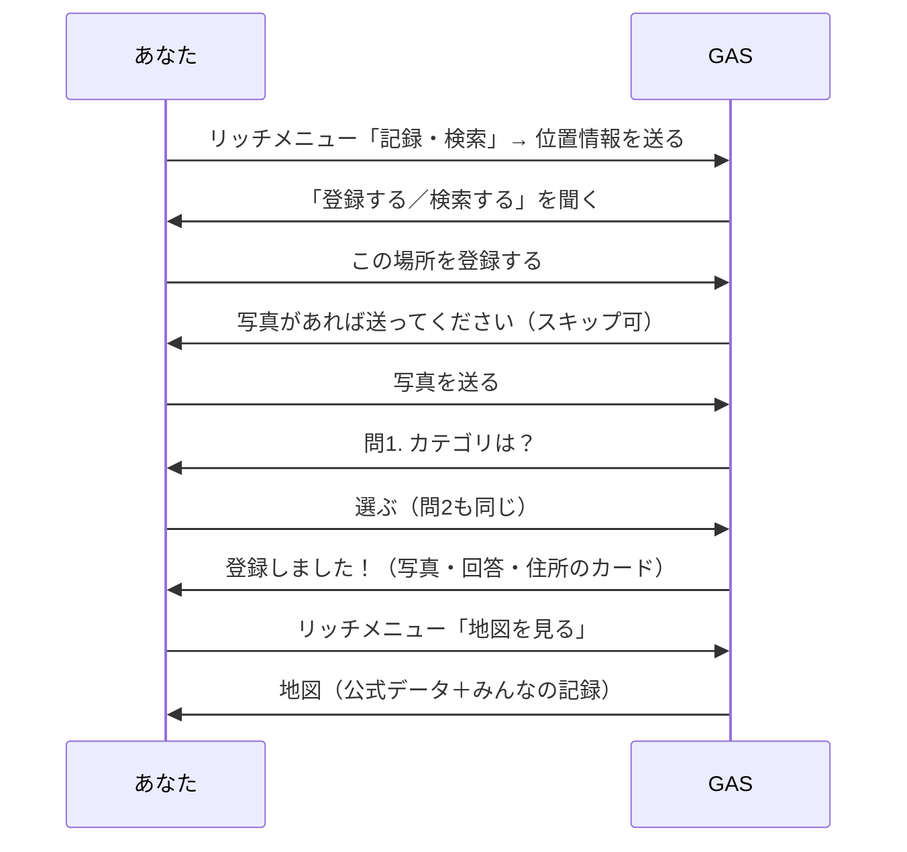

Step2 まで動いていれば、まちの記憶アーカイブBot の必須パートはできあがっています。ここからは**もくもくタイム**です。

## 完成形のデモ

もくもく機能を全部入れると、Bot はこう動きます。写真・登録完了のカード・地図・リッチメニュー・QRコードが、1本の流れにつながります。

選んだ機能だけでも動きます。たとえば、写真を足さなければ「スキップ」の確認は出ず、問1にそのまま進みます。

## 選び方

**好きなものを、好きな順に、好きな数だけ**選んでください。1つをじっくり作り込んでも、いくつかを軽くつまんでも大丈夫です。

| 機能 | 難易度 | 使うもの | 章 |
| :--- | :--- | :--- | :--- |
| 写真を保存する | ★☆☆ | Google Drive | [写真をアップロードする](./03-01-photo-upload) |
| 検索結果と登録完了をカードにする | ★★☆ | Flex Message | [FlexMessageで結果をカードにする](./03-02-flex-message) |
| メニューを常に出す | ★★☆ | リッチメニュー | [リッチメニューを作る](./03-03-rich-menu) |
| 地図にピンを立てる（写真・公式データつき） | ★★☆ | doGet, Leaflet.js | [マップへ表示する](./03-04-map-display) |
| 場所に貼る QR コード・地図の共有 | ★☆☆ | QR コード生成サービス | [QRコードを作る](./03-06-qr-code) |
| 登録した場所の一覧・削除 | ★☆☆ | クイックリプライ | [登録した場所の一覧・削除](./03-08-list-delete) |

迷ったら、**「写真をアップロードする」か「QRコードを作る」**から始めるのがおすすめです。どちらも短く、ほかの章に関係なく動きます。

## この先の章の読み方

どの章も、**Step2 が終わった時点のコードに1つ機能を足す**形で書いています。ほかの 🎖️ 章を先にやっていても、そのまま進められます。

いくつか組み合わせると、`コード.gs` の同じ関数に何章ぶんも書き足すことになります。diff の `+` の前後に出ている行を目印にして、同じ場所に足してください。全部入れた完成形は「[全部盛りのGASコード](./04-01-full-source)」にあります。

:::message
どの章も APIキーや追加の契約は要りません。QR コードや地図の画像は、無料の外部サービスから読み込みます。
:::
