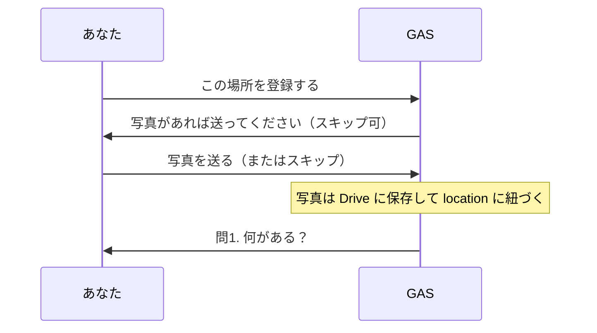
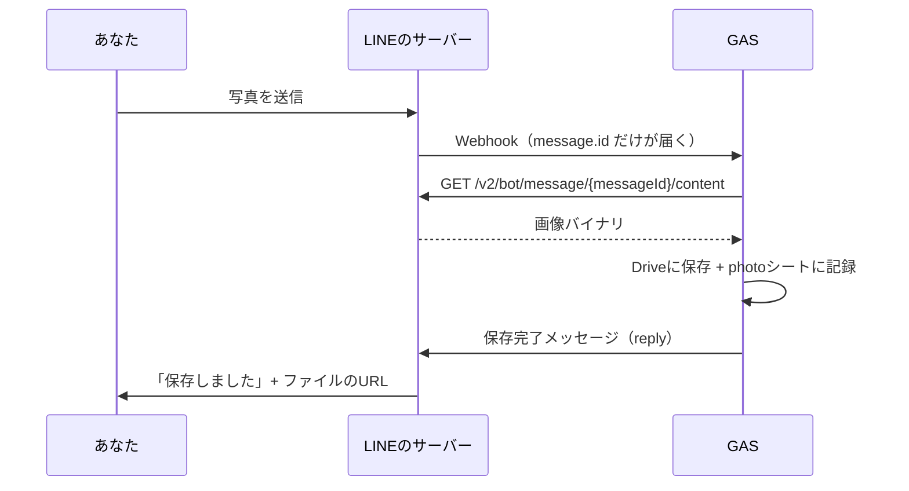

位置情報だけでなく、**写真も残せる**ようにします。LINE で送った写真を Google Drive のフォルダに保存し、`photo` シートに記録します。さらに、「この場所を登録する」を押したあとに写真を送ると、**登録中の場所に写真がひもづく**ようにします。



写真を送らなくても、「スキップ」を押せばこれまでどおり問1に進みます。登録の流れの外で写真を送ったときは、保存だけします。

## 写真は中身を取りに行く

写真を送ると、`doPost` には `event.message.type === "image"` のイベントが届きます。ただし、**写真そのものはイベントに入っていません。** 入っているのは `message.id` だけなので、それを使って別の API に取りに行きます。



:::message
写真を取りに行く先は `api.line.me` ではなく **`api-data.line.me`** です。`-data` が付くだけの違いなので、見落としやすいところです。

送られた写真は、一定期間がたつと LINE のサーバーから消えます。なので `doPost` の中で、届いたその場で取りに行きます。
:::

## 保存先のフォルダを作る

保存先のフォルダは、**エディタから1回だけ実行する関数**で作ります。フォルダ ID を手でコピーしなくて済みます。

新しいファイル `写真アップロード.gs` を作り、貼り付けます。

```javascript:写真アップロード.gs
function setupPhotoFolder() {
  var props = PropertiesService.getScriptProperties();
  if (props.getProperty("DRIVE_FOLDER_ID")) {
    console.log("すでに設定済みです: " + props.getProperty("DRIVE_FOLDER_ID"));
    return;
  }

  var folder = DriveApp.createFolder("まちの記憶アーカイブ 写真");
  props.setProperty("DRIVE_FOLDER_ID", folder.getId());
  console.log("フォルダを作成しました: " + folder.getUrl());
}
```

エディタ上部の関数プルダウンで **`setupPhotoFolder`** を選び、「実行」します。

:::message alert
初回は **Drive へのアクセス許可**を求められます。ここで許可しないと、写真を保存するときにエラーになります。Step1 のデプロイと同じ赤い警告が出ますが、正常です。
:::

マイドライブに「まちの記憶アーカイブ 写真」フォルダができ、スクリプトプロパティに `DRIVE_FOLDER_ID` が入っていれば準備完了です。2回目以降は「すでに設定済みです」と出るだけなので、何度押しても大丈夫です。

## photo シートを足す

`コード.gs` の先頭の `SHEET_NAMES` と `HEADERS` に `PHOTO` を足します。シートは最初の写真が届いたときに自動でできます。あわせて、`location` シートの H 列に **`写真URL`** を足します（登録中の場所に写真をひもづけるための列です）。

```diff:コード.gs
 var SHEET_NAMES = {
   LOCATION: "location",
   POSTBACK: "postback",
   LOG: "log",
   STATE: "state",
   QUESTION: "question",
   ANSWER: "answer",
-  SUBMISSION: "submission"
+  SUBMISSION: "submission",
+  PHOTO: "photo"
 };

 var HEADERS = {
-  LOCATION: ["送信日時", "ユーザーID", "メッセージID", "タイトル", "住所", "緯度", "経度"],
+  LOCATION: ["送信日時", "ユーザーID", "メッセージID", "タイトル", "住所", "緯度", "経度", "写真URL"],
   POSTBACK: ["送信日時", "ユーザーID", "メッセージID", "位置情報メッセージID", "データ", "表示テキスト"],
   LOG: ["記録日時", "ユーザーID", "イベント種別", "JSON"],
-  STATE: ["user_id", "status", "payload", "updated_at"]
+  STATE: ["user_id", "status", "payload", "updated_at"],
+  PHOTO: ["送信日時", "ユーザーID", "メッセージID", "ファイル名", "ファイルID", "URL"]
 };
```

:::message alert
`location` シートは 02-01 ですでにできているので、`HEADERS` を変えても見出しは書き足されません（見出しを書くのはシートを作るときだけです）。スプレッドシートの `location` シートを開き、**H1 セルに手で `写真URL` と入力**してください。
:::

## 写真を受け取って保存する

`写真アップロード.gs` に続けて貼り付けます。

```javascript:写真アップロード.gs
function handleImageMessage(replyToken, userId, msg) {
  try {
    if (msg.contentProvider && msg.contentProvider.type !== "line") {
      replyText(replyToken, "この写真は保存に対応していない形式でした。");
      return;
    }

    var blob = fetchLineImageContent(msg.id);
    var file = savePhotoToDrive(blob, msg.id);
    savePhoto(userId, msg.id, file.getName(), file.getId(), file.getUrl());
    replyText(replyToken, "写真を保存しました！\n" + file.getUrl());
  } catch (err) {
    console.error("photo/error", err);
    replyText(replyToken, "写真の保存に失敗しました。もう一度送ってみてください。");
  }
}

function fetchLineImageContent(messageId) {
  var lineToken = PropertiesService.getScriptProperties().getProperty("LINE_ACCESS_TOKEN");
  var response = UrlFetchApp.fetch("https://api-data.line.me/v2/bot/message/" + messageId + "/content", {
    method: "get",
    headers: { Authorization: "Bearer " + lineToken },
    muteHttpExceptions: true
  });

  if (response.getResponseCode() !== 200) {
    throw new Error("画像取得に失敗 (" + response.getResponseCode() + "): " + response.getContentText());
  }
  return response.getBlob();
}

function savePhotoToDrive(blob, messageId) {
  var folderId = PropertiesService.getScriptProperties().getProperty("DRIVE_FOLDER_ID");
  if (!folderId) throw new Error("スクリプトプロパティに DRIVE_FOLDER_ID がありません（setupPhotoFolder を実行してください）");

  var folder = DriveApp.getFolderById(folderId);
  var ext = blob.getContentType() === "image/png" ? ".png" : ".jpg";
  var fileName = Utilities.formatDate(new Date(), "Asia/Tokyo", "yyyyMMdd_HHmmss") + "_" + messageId + ext;
  blob.setName(fileName);
  var file = folder.createFile(blob);
  // 地図やカードの  に出すため、リンクを知っている人は見られるようにする
  file.setSharing(DriveApp.Access.ANYONE_WITH_LINK, DriveApp.Permission.VIEW);
  return file;
}

function buildThumbnailUrl(fileId) {
  return "https://drive.google.com/thumbnail?id=" + fileId + "&sz=w400";
}

function savePhoto(userId, messageId, fileName, fileId, fileUrl) {
  var sheet = getOrCreateSheet(SHEET_NAMES.PHOTO);
  sheet.appendRow([new Date(), userId, messageId, fileName, fileId, fileUrl]);
}
```

`handleImageMessage` が入口で、「取りに行く → Drive に保存 → シートに記録 → 返信」の順に呼んでいます。保存した写真は、あとでカードや地図の画像として出すため、`setSharing` で「リンクを知っている人は見られる」にしています。`buildThumbnailUrl` は、そのファイルの縮小画像の URL を作ります。

`contentProvider.type` が `line` でない写真は、LINE のサーバーに中身がありません（外部の URL で届くもの）。このハンズオンでは保存せずに断ります。

途中で失敗したら、`catch` でユーザーに「失敗しました」とだけ返し、原因は実行ログ（`console.error`）に残します。取りに行く `fetch` に `muteHttpExceptions: true` を付けているのは、200 以外のときに自分でステータスコードを見てエラーにするためです。

:::message alert
写真は「**リンクを知っている人なら誰でも見られる**」状態で保存されます。地図やカードに写真を出すための設定です。私有地の中や、人の顔が写った写真は送らないようにしてください。
:::

## 登録の流れに写真を挟む

ここからが本題です。「この場所を登録する」を押したあとに、写真を待つ状態を1つ挟みます。`state` の `status` は、これまでの `pending_choice → answering → done` に、`waiting_photo` が加わります。

まず、`写真アップロード.gs` に、写真を促す関数と、`location` シートの H 列に写真 URL を書く関数を足します。`handleImageMessage` は、登録中の写真ならそのまま問1へ進むように書き換えます。

:::message alert
下のコードにも `handleImageMessage` が入っています。**さっき貼った `handleImageMessage` は消して**、下のコードに置き換えてください。同じ名前の関数が2つあると、どちらが動いているのか分からなくなります。
:::

```javascript:写真アップロード.gs
function askPhoto(replyToken, locationId) {
  var quickReply = {
    items: [
      { type: "action", action: { type: "camera", label: "カメラを開く" } },
      { type: "action", action: { type: "cameraRoll", label: "写真を選ぶ" } },
      {
        type: "action",
        action: {
          type: "postback",
          label: "スキップ",
          data: JSON.stringify({ action: "skip_photo", locationId: locationId }),
          displayText: "スキップ"
        }
      }
    ]
  };
  replyTextWithQuickReply(replyToken, "写真があれば送ってください📷\nなければ「スキップ」を押してください", quickReply);
}

function setLocationPhoto(locationId, photoUrl) {
  var sheet = getOrCreateSheet(SHEET_NAMES.LOCATION);
  var match = sheet.getRange("C:C").createTextFinder(locationId).matchEntireCell(true).findNext();
  if (!match) return false;

  sheet.getRange(match.getRow(), 8).setValue(photoUrl);
  return true;
}

function handleImageMessage(replyToken, userId, msg) {
  try {
    if (msg.contentProvider && msg.contentProvider.type !== "line") {
      replyText(replyToken, "この写真は保存に対応していない形式でした。");
      return;
    }

    var blob = fetchLineImageContent(msg.id);
    var file = savePhotoToDrive(blob, msg.id);
    savePhoto(userId, msg.id, file.getName(), file.getId(), file.getUrl());

    var state = getState(userId);
    if (state && state.status === "waiting_photo") {
      var place = state.payload;
      place.photoUrl = buildThumbnailUrl(file.getId());
      setLocationPhoto(place.locationId, place.photoUrl);
      setState(userId, "answering", place);
      askQuestion(replyToken, place.locationId, 1, "写真を保存しました！");
      return;
    }

    replyText(replyToken, "写真を保存しました！\n" + file.getUrl());
  } catch (err) {
    console.error("photo/error", err);
    replyText(replyToken, "写真の保存に失敗しました。もう一度送ってみてください。");
  }
}
```

`askPhoto` の返信には、3つのボタン（クイックリプライ）を付けています。`type: "camera"` は**カメラを開き**、`type: "cameraRoll"` は**写真の一覧（カメラロール）を開きます**。どちらも、撮った・選んだ写真がそのままトークに送られ、`image` イベントとして届きます。「スキップ」だけが `postback` で、`doPost` に届きます。

`state` が `waiting_photo` のときだけ、写真を登録中の場所にひもづけます。サムネイル URL を `state` の `payload` にも持たせておくのは、あとで完了カードに写真を出せるようにするためです。それ以外のときは、これまでどおり保存だけして返信します。

問1を出す `askQuestion` には、先頭に一言足せる引数 `prefix` を足します。「写真を保存しました！」と問1を、1回の返信にまとめるためです。

```javascript:Question.gs
function askQuestion(replyToken, locationId, n, prefix) {
  var question = getQuestions()[n - 1];
  if (!question) {
    replyText(replyToken, "質問が見つかりません。question シートを確かめてください（setupSheets を実行）。");
    return;
  }

  var items = [];
  question.choices.forEach(function (choice, i) {
    if (choice === "") return;
    items.push({
      type: "action",
      action: {
        type: "postback",
        label: choice.slice(0, 20),
        data: JSON.stringify({ action: "answer", locationId: locationId, question: n, choice: i + 1 }),
        displayText: choice
      }
    });
  });
  replyTextWithQuickReply(replyToken, (prefix ? prefix + "\n" : "") + "問" + n + ". " + question.text, { items: items });
}
```

最後に `コード.gs` の `handlePostback` を直します。「この場所を登録する」で、問1ではなく写真を促すようにします。「スキップ」の分岐と、`isCurrentButton` の許可も足します。

```diff:コード.gs
     place.answers = {};
-    setState(userId, "answering", place);
-    askQuestion(replyToken, place.locationId, 1);
+    setState(userId, "waiting_photo", place);
+    askPhoto(replyToken, place.locationId);
+    return;
+  }
+
+  if (data.action === "skip_photo") {
+    setState(userId, "answering", state.payload);
+    askQuestion(replyToken, state.payload.locationId, 1);
     return;
   }
```

```diff:コード.gs
   if (data.action === "answer") {
     return state.status === "answering" && state.payload.question === data.question;
   }
+  if (data.action === "skip_photo") {
+    return state.status === "waiting_photo";
+  }
   return state.status === "pending_choice";
```

`waiting_photo` の状態も、これまでと同じく30分たつと切れます。写真を待ったまま放っておいても、あとで位置情報を送り直せば元に戻ります。

## doPost に分岐を足す

`msg.type` の判定に `image` を足します。

```diff:コード.gs
       } else if (msg.type === "location") {
         var place = toPlace(event.webhookEventId, msg);
         saveLocation(userId, place);
         handleLocationMessage(event.replyToken, userId, place);
+
+      } else if (msg.type === "image") {
+        handleImageMessage(event.replyToken, userId, msg);
       }
```

再デプロイして、LINE で写真を送ってみます。

## ✅ 確認

1. 位置情報を送り、「この場所を登録する」を押す
   → 「写真があれば送ってください」と、「カメラを開く」「写真を選ぶ」「スキップ」のボタンが出る

   

2. 「カメラを開く」か「写真を選ぶ」を押して写真を送る
   → 「写真を保存しました！」のあと、「問1. 何がある？」が出る

   

3. Drive の「まちの記憶アーカイブ 写真」フォルダにファイルが増えている

`photo` シートに写真の行（ファイル名・ファイルID・URL）が、`location` シートの H 列に写真 URL が入っていれば成功です。「スキップ」を押したときは、写真なしで問1に進みます。登録の流れの外で写真を送ると、`photo` シートに残るだけで、返信に Drive の URL が付きます。

## 🎖️ 早く終わった人へ

### 🎖️ 複数枚まとめて送ったとき

アルバムから何枚かまとめて送ると、LINE は1枚ずつ別の `image` イベントとして届けます。`doPost` はイベントを1件ずつ処理するので、**何もしなくても全部保存されます。**「保存しました」の返事も枚数ぶん届きます。

返事を1回にまとめたい人は、`event.message.imageSet` を見てみてください。まとめて送った写真には、同じ `imageSet.id` と、何枚目か（`index`）・全部で何枚か（`total`）が入っています。

### 🎖️ 写真を送り直せるようにする

いまは、問1に進んだあとで写真を送っても、場所には紐づきません（登録の流れの外の写真として、保存だけされます）。回答の途中でも写真を差し替えられるようにするには、`handleImageMessage` が見る状態を `waiting_photo` だけでなく、`answering` にも広げます。

:::details 進め方のヒント
`state.payload.locationId` が、いま登録中の場所です。`answering` のときも `setLocationPhoto(place.locationId, ...)` を呼べば、`location` の H 列を上書きできます。ただし `setState` で `waiting_photo` に戻してしまうと、回答の途中から進めなくなるので、`status` と `payload.question` は変えないでください。
:::

### 🎖️ フォルダを日付やユーザーごとに分ける

いまは全員の写真を1つのフォルダに入れています。`getFoldersByName(name)` で探して、無ければ `createFolder(name)` で作れば、年月やユーザーごとのサブフォルダに分けられます。
