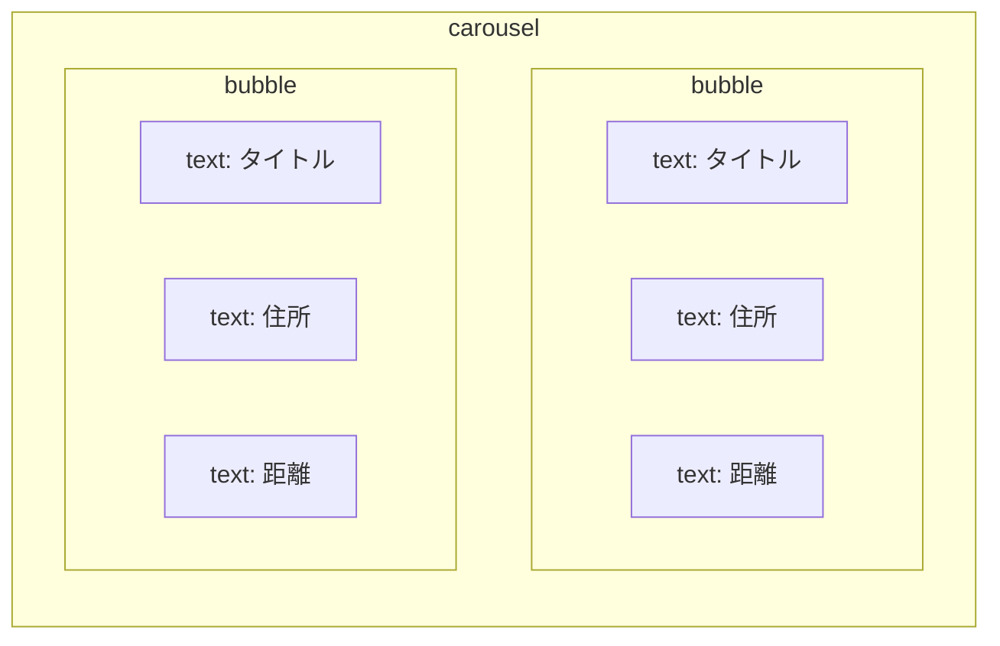

「[GPS検索を作る](./02-04-gps-search)」の検索結果は、テキストの一覧でした。これを**横にスワイプできるカード**（Flex Message）にします。さらに、登録が終わったときの「登録しました！」も、**写真・回答・住所が並んだ1枚のカード**にします。

## Flex Message の形

Flex Message は、箱（`box`）の中に部品（`text` など）を並べて作ります。カード1枚が `bubble`、それを横に並べたものが `carousel` です。今回は「1か所 = 1枚」のカードを作り、`carousel` に並べます。



## カードを組み立てる

新しいファイル `FlexMessage.gs` を作り、貼り付けます。

```javascript:FlexMessage.gs
function buildLocationFlexCarousel(results) {
  var mapUrl = ScriptApp.getService().getUrl() + "?view=map";
  var bubbles = results.map(function (r) {
    return {
      type: "bubble",
      footer: {
        type: "box",
        layout: "vertical",
        contents: [
          { type: "button", style: "link", action: { type: "uri", label: "地図で見る", uri: mapUrl + "&id=" + encodeURIComponent(r.locationId) } }
        ]
      },
      body: {
        type: "box",
        layout: "vertical",
        spacing: "sm",
        contents: [
          { type: "text", text: r.title, weight: "bold", size: "lg", wrap: true },
          { type: "text", text: r.address, size: "sm", color: "#888888", wrap: true },
          { type: "text", text: r.distanceKm.toFixed(2) + " km", size: "sm", margin: "md", color: "#4a86e8", weight: "bold" }
        ]
      }
    };
  });

  return {
    type: "flex",
    altText: "近い順に見つかった場所です",
    contents: { type: "carousel", contents: bubbles }
  };
}

function replyFlex(replyToken, flexMessage) {
  reply(replyToken, [flexMessage]);
}
```

検索結果1件ごとに `bubble` を1つ作っているだけです。`altText` は、通知やトーク一覧に出る文字です。カードの下の「地図で見る」ボタンは、`?view=map&id=` のあとに**その場所の ID** を付けた地図の URL を開きます。地図は全体ではなく、その場所を中心に出ます。地図そのものは [マップへ表示する](./03-04-map-display) で作るので、この章だけ進めた段階では、ボタンを押しても地図は出ません。

:::message alert
`carousel` に入れられる `bubble` は**12個まで**です。検索件数を増やすときは、12件を超えないようにしてください（Step2 のままなら5件です）。
:::

## 検索結果をカードで返す

`handlePostback` の「検索する」の分岐を書き換えます。

```diff:コード.gs
   if (data.action === "search") {
     var results = searchNearbyLocations(state.payload.latitude, state.payload.longitude, 5);
-    replyText(replyToken, formatSearchResults(results));
+    if (results.length === 0) {
+      replyText(replyToken, "登録された場所がまだありません。まずは場所を1件登録してみてください。");
+    } else {
+      replyFlex(replyToken, buildLocationFlexCarousel(results));
+    }
     clearState(userId);
     return;
   }
```

結果が0件のときは、空のカルーセルにならないようテキストで返します。

## 登録完了のカードを作る

登録の最後の返事も、カードにします。`FlexMessage.gs` に続けて貼り付けます。

```javascript:FlexMessage.gs
/**
 * 登録が終わったときのカード。写真があれば一番上に出す。
 * place.answers は {1: "観光地", 2: "ぜひ"} の形、questions は getQuestions() の結果。
 */
function buildCompletionCard(place, questions) {
  var answerRows = questions.map(function (q, i) {
    return {
      type: "box",
      layout: "baseline",
      spacing: "sm",
      contents: [
        { type: "text", text: q.text, size: "sm", color: "#888888", flex: 4, wrap: true },
        { type: "text", text: place.answers[i + 1] || "-", size: "sm", weight: "bold", flex: 3, wrap: true }
      ]
    };
  });

  var bubble = {
    type: "bubble",
    body: {
      type: "box",
      layout: "vertical",
      spacing: "sm",
      contents: [
        { type: "text", text: "登録しました！", size: "xs", color: "#4a86e8", weight: "bold" },
        { type: "text", text: place.title, weight: "bold", size: "lg", wrap: true },
        { type: "text", text: place.address, size: "sm", color: "#888888", wrap: true }
      ].concat(answerRows)
    },
    footer: {
      type: "box",
      layout: "vertical",
      contents: [
        { type: "button", style: "primary", action: { type: "uri", label: "地図で見る", uri: ScriptApp.getService().getUrl() + "?view=map&id=" + encodeURIComponent(place.locationId) } }
      ]
    }
  };

  if (place.photoUrl) {
    bubble.hero = { type: "image", url: place.photoUrl, size: "full", aspectRatio: "20:13", aspectMode: "cover" };
  }

  return { type: "flex", altText: "登録しました：" + place.title, contents: bubble };
}
```

完了カードの「地図で見る」も、いま登録した場所の ID を付けているので、押すと登録した場所が中心の地図が開きます。質問と回答を `questions` の数だけ並べているので、`question` シートの質問を増やしても、そのままカードに出ます。`place.photoUrl` は、[写真をアップロードする](./03-01-photo-upload) で `state` の `payload` に入れたサムネイル URL です。その章を飛ばしていれば `photoUrl` が無いので、写真の欄は出ません。

`handlePostback` の、最後の質問に答えたあとの分岐を書き換えます。

```diff:コード.gs
     clearState(userId);
-    var lines = questions.map(function (q, i) {
-      return q.text + " " + (answering.answers[i + 1] || "");
-    });
-    replyText(replyToken, "登録しました！\n" + lines.join("\n"));
+    replyFlex(replyToken, buildCompletionCard(answering, questions));
     return;
```

再デプロイして試します。

## ✅ 確認

1. 位置情報を送って「近くを検索する」を押す
   → テキストの代わりに、タイトル・住所・距離が書かれたカードが横並びで返ってくる

   
2. 位置情報を送って「この場所を登録する」を押し、全部の質問に答える
   → 「登録しました！」のカードが返ってくる（写真を送っていれば、一番上に写真が出る）

   

## 🎖️ 早く終わった人へ

### 🎖️ カードに色を付ける

:::details 答えを見る
`bubble` に `styles` を足すと、ブロックごとに背景色を付けられます。ここでは本体（`body`）を薄い青にします。

```diff:FlexMessage.gs
     return {
       type: "bubble",
+      styles: {
+        body: { backgroundColor: "#F5F9FF" }
+      },
       body: {
```
:::

### 🎖️ 挿絵として使う

```
===
挿絵prompt
スマホのLINEのトーク画面に、地図のピンのアイコン付きカードが3枚横並びで表示されている様子。各カードにはお店の名前・住所・距離がシンプルなアイコンとともに書かれている、フラットデザインのUIモックアップ風イラスト。
===
```
