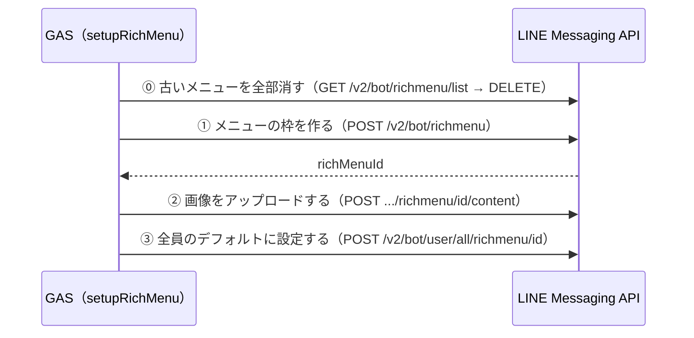

トーク画面の下にいつも出ている、タップ式のメニュー（リッチメニュー）を作ります。この章で書くのは Webhook の処理ではありません。**エディタから1回だけ実行するセットアップ関数**です。`コード.gs` には触りません。

## 作る手順は4回の API 呼び出し



枠（どこを押すと何が起きるか）と画像は別々に登録します。最後に「全員のデフォルト」にすると、友だち全員のトーク画面に出ます。

## メニュー画像は用意してあります

メニューは3つのボタンに分けます。画像は **2500×843px** で、あらかじめ作ったものを使います。


| ボタン | 押すと |
| :--- | :--- |
| 記録・検索 | LINE の位置情報の送信画面が開く |
| 地図を見る | 地図（[マップへ表示する](./03-04-map-display)）が開く |
| 地図を共有 | 「地図を共有」が送られ、地図 URL の QR コードが返ってくる（[QRコードを作る](./03-06-qr-code)） |

画像は、このハンズオンの素材置き場（GitHub の `LDGQ/assets` リポジトリの `nara-line-location-log-handson/richmenu/richmenu-nara.png`）に置いてあります。自分で用意する必要はありません。コードでは、GitHub 上のこのファイルの URL を `RICH_MENU_IMAGE_URL` に入れ、それを読みに行きます。

:::message
自分で作った画像を使うときは、どこかに公開して URL で読める状態にし、`RICH_MENU_IMAGE_URL` を差し替えます。コードは PNG として送っているので、画像は PNG・1MB 以下にしておきます（JPEG を使うなら `contentType` を `image/jpeg` に変えます）。高さを変えるときは、`size` と `bounds` の `height` も合わせてください。
:::

## コードを書く

新しいファイル `リッチメニュー.gs` を作ります。

```javascript:リッチメニュー.gs
/**
 * GASエディタから直接実行する（doPostからは呼ばない、一度だけのセットアップ処理）。
 */
var RICH_MENU_IMAGE_URL = "https://raw.githubusercontent.com/LDGQ/assets/main/nara-line-location-log-handson/richmenu/richmenu-nara.png";

function setupRichMenu() {
  deleteAllRichMenus();
  var richMenuId = createRichMenu();
  uploadRichMenuImage(richMenuId, RICH_MENU_IMAGE_URL);
  setDefaultRichMenu(richMenuId);
  console.log("設定完了: " + richMenuId);
}

function deleteAllRichMenus() {
  var lineToken = PropertiesService.getScriptProperties().getProperty("LINE_ACCESS_TOKEN");
  var response = UrlFetchApp.fetch("https://api.line.me/v2/bot/richmenu/list", {
    method: "get",
    headers: { Authorization: "Bearer " + lineToken }
  });

  (JSON.parse(response.getContentText()).richmenus || []).forEach(function (menu) {
    UrlFetchApp.fetch("https://api.line.me/v2/bot/richmenu/" + menu.richMenuId, {
      method: "delete",
      headers: { Authorization: "Bearer " + lineToken }
    });
    console.log("削除: " + menu.richMenuId);
  });
}

function createRichMenu() {
  var lineToken = PropertiesService.getScriptProperties().getProperty("LINE_ACCESS_TOKEN");
  var mapUrl = ScriptApp.getService().getUrl() + "?view=map";
  var body = {
    size: { width: 2500, height: 843 },
    selected: true,
    name: "まちの記憶アーカイブ",
    chatBarText: "メニュー",
    areas: [
      {
        bounds: { x: 0, y: 0, width: 833, height: 843 },
        action: { type: "uri", label: "記録・検索", uri: "https://line.me/R/nv/location" }
      },
      {
        bounds: { x: 833, y: 0, width: 834, height: 843 },
        action: { type: "uri", label: "地図を見る", uri: mapUrl }
      },
      {
        bounds: { x: 1667, y: 0, width: 833, height: 843 },
        action: { type: "message", label: "地図を共有", text: "地図を共有" }
      }
    ]
  };

  var response = UrlFetchApp.fetch("https://api.line.me/v2/bot/richmenu", {
    method: "post",
    contentType: "application/json",
    headers: { Authorization: "Bearer " + lineToken },
    payload: JSON.stringify(body)
  });
  return JSON.parse(response.getContentText()).richMenuId;
}

function uploadRichMenuImage(richMenuId, imageUrl) {
  var lineToken = PropertiesService.getScriptProperties().getProperty("LINE_ACCESS_TOKEN");
  var imageBlob = UrlFetchApp.fetch(imageUrl).getBlob();

  UrlFetchApp.fetch("https://api-data.line.me/v2/bot/richmenu/" + richMenuId + "/content", {
    method: "post",
    contentType: "image/png",
    headers: { Authorization: "Bearer " + lineToken },
    payload: imageBlob
  });
}

function setDefaultRichMenu(richMenuId) {
  var lineToken = PropertiesService.getScriptProperties().getProperty("LINE_ACCESS_TOKEN");
  UrlFetchApp.fetch("https://api.line.me/v2/bot/user/all/richmenu/" + richMenuId, {
    method: "post",
    headers: { Authorization: "Bearer " + lineToken }
  });
}
```

`areas` で画像を左から3等分し、それぞれにアクションを付けています。アクションの種類は2つ使います。

- **`type: "uri"`**: 押すと、その URL を開きます。1つ目の `https://line.me/R/nv/location` は LINE の位置情報の送信画面で、「位置情報を送ってください」と聞き返さなくても、すぐ送れます。2つ目は地図の URL です
- **`type: "message"`**: 押すと、そのテキストを自分で送ったのと同じことになります。3つ目は「地図を共有」を送ります

`setupRichMenu` は、最初に `deleteAllRichMenus` で**いまあるメニューを全部消してから**作ります。何回実行しても、メニューが増えずに作り直しになります。

位置情報を送ったあとの「登録する／近くを検索する」は、これまでどおり Bot が聞いてきます。メニューには検索の専用ボタンを置かず、位置情報を送る入口を1つにしています。

## 実行する

エディタ上部の関数プルダウンで **`setupRichMenu`** を選び、「実行」します。実行ログに「設定完了: richmenu-...」と出れば、LINE 側への登録は終わりです。

:::message alert
`setupRichMenu` は**手で1回だけ**実行します。`doPost` から呼ぶと、メッセージが届くたびにリッチメニューが増えていきます。
:::

## ✅ 確認

スマホの LINE でトーク画面を開き直すと、下にメニューが出ます。

1. 「記録・検索」を押す
   → 位置情報の送信画面が開く
2. 「地図を見る」を押す
   → 地図のページが開く（[マップへ表示する](./03-04-map-display) をまだ作っていなければ「スクリプト関数が見つかりません: doGet」と出ます。正常です）
3. 「地図を共有」を押す
   → 「地図を共有」が送られる（QR コードが返るのは [QRコードを作る](./03-06-qr-code) のあとです）

## 🎖️ 早く終わった人へ

### 🎖️ 古いメニューを消さずに残す

:::details 進め方のヒント
`setupRichMenu` の最初の `deleteAllRichMenus();` の行を消せば、古いメニューは残ります（デフォルトだけが新しいメニューに切り替わります）。メニューを何種類か使い分けたいときは、`richMenuId` を控えておき、`POST /v2/bot/user/{userId}/richmenu/{richMenuId}` で人ごとに切り替えられます。
:::

### 🎖️ タップ領域を増やす

:::details 答えを見る
`areas` の配列に4つ目を足せば、4分割のメニューになります。`bounds` の `x` と `width` を、横幅 2500 を4等分するように調整してください（画像も作り直します）。
:::
