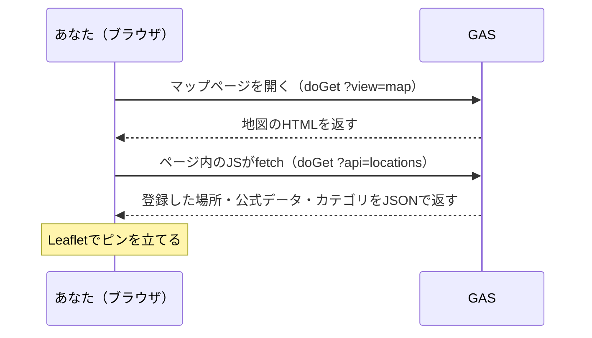

送った場所を、地図にピンで並べるページを作ります。地図は **Leaflet.js + OpenStreetMap** を使います。どちらも無料で、API キーも要りません。

ピンには、登録のときに送った**写真**と**質問の答え**を出します。質問1の答え（カテゴリ）ごとにピンの色を変え、**公式データ**（ハンズオン用に用意した、奈良の指定文化財や観光施設）を灰色のピンで重ねます。「公式に載っている場所」と「みんなが見つけた場所」を、1枚の地図で見比べるためです。

## 全体の流れ



GAS のウェブアプリは、LINE から届く `doPost` だけでなく、ブラウザで開いたときの `doGet` も受けられます。この本で `doGet` を使うのはこの章だけです。

同じ URL を2回使います。1回目はブラウザで開いて地図の HTML をもらい、2回目は地図のページの中から `?api=locations` を付けて呼び、ピンの位置を JSON でもらいます。

## 公式データを用意する

新しいファイル `OfficialData.gs` を作ります。公式データは、地図に重ねる固定の一覧です。

```javascript:OfficialData.gs
/**
 * 公式データ（ハンズオン用のモック）。地図に灰色のピンで重ねる。
 */
var OFFICIAL_PLACES = [
  { title: "東大寺", address: "奈良県奈良市雑司町406-1", latitude: 34.6889, longitude: 135.8398, kind: "指定文化財" },
  { title: "春日大社", address: "奈良県奈良市春日野町160", latitude: 34.6814, longitude: 135.8481, kind: "指定文化財" },
  { title: "興福寺 五重塔", address: "奈良県奈良市登大路町48", latitude: 34.6851, longitude: 135.8325, kind: "指定文化財" },
  { title: "奈良国立博物館", address: "奈良県奈良市登大路町50", latitude: 34.6841, longitude: 135.8388, kind: "観光・文化施設" },
  { title: "ならまち格子の家", address: "奈良県奈良市元興寺町44", latitude: 34.6789, longitude: 135.8296, kind: "観光・文化施設" },
  { title: "奈良県立美術館", address: "奈良県奈良市登大路町10-6", latitude: 34.6847, longitude: 135.8342, kind: "観光・文化施設" }
];
```

実際の自治体のオープンデータを使うときは、この配列を差し替えます。まずは6件のままで動かします。

## コードを書く

新しいファイル `マップ表示.gs` を作ります。

```javascript:マップ表示.gs
function doGet(e) {
  var params = e.parameter;

  if (params.api === "locations") {
    return ContentService
      .createTextOutput(JSON.stringify(getMapData()))
      .setMimeType(ContentService.MimeType.JSON);
  }

  return mapHtml(params.id);
}

function getMapData() {
  var questions = getQuestions();
  var categories = questions.length > 0
    ? questions[0].choices.filter(function (c) { return c !== ""; })
    : [];
  return {
    locations: getAllLocationsAsJson(),
    official: OFFICIAL_PLACES,
    categories: categories
  };
}

function getAllLocationsAsJson() {
  var photoUrls = readPhotoUrls();
  return readSubmissionWithAnswers().map(function (loc) {
    loc.photoUrl = photoUrls[loc.locationId] || "";
    return loc;
  });
}

/**
 * submission（全問に答えた場所）を、回答つきで読む。
 * 6列目以降が質問ごとの回答で、1行目に質問文が入っている。
 */
function readSubmissionWithAnswers() {
  var sheet = SpreadsheetApp.getActiveSpreadsheet().getSheetByName(SHEET_NAMES.SUBMISSION);
  if (!sheet || sheet.getLastRow() < 2) return [];

  var width = sheet.getLastColumn();
  var values = sheet.getRange(1, 1, sheet.getLastRow(), width).getValues();
  var header = values[0];

  return values
    .slice(1)
    .filter(function (row) { return typeof row[3] === "number"; })
    .map(function (row) {
      var answers = [];
      for (var i = 5; i < width; i++) {
        if (header[i] !== "") answers.push({ question: String(header[i]), answer: String(row[i]) });
      }
      return { locationId: row[0], title: row[1], address: row[2], latitude: row[3], longitude: row[4], answers: answers };
    });
}

/**
 * location の H 列（写真URL）を 場所ID → URL の形で返す。写真が無い場所は入らない。
 */
function readPhotoUrls() {
  var sheet = SpreadsheetApp.getActiveSpreadsheet().getSheetByName(SHEET_NAMES.LOCATION);
  if (!sheet || sheet.getLastRow() < 2) return {};

  var values = sheet.getRange(2, 3, sheet.getLastRow() - 1, 6).getValues();
  var urls = {};
  values.forEach(function (row) {
    if (row[5]) urls[row[0]] = row[5];
  });
  return urls;
}

function mapHtml(focusId) {
  var apiUrl = ScriptApp.getService().getUrl() + "?api=locations";
  var script = [
    "var FOCUS_ID = " + JSON.stringify(focusId || "") + ";",
    "var COLORS = ['#d62828', '#1d4ed8', '#7e22ce', '#0f766e', '#a16207'];",
    "var map = L.map('map').setView([34.6851, 135.8048], 13);",
    "L.tileLayer('https://{s}.tile.openstreetmap.org/{z}/{x}/{y}.png', {",
    "  attribution: '&copy; OpenStreetMap contributors'",
    "}).addTo(map);",
    "var group = L.markerClusterGroup({ maxClusterRadius: 40 }).addTo(map);",
    "function esc(s) {",
    "  return String(s).split('&').join('&amp;').split('<').join('&lt;').split('>').join('&gt;');",
    "}",
    "fetch('" + apiUrl + "').then(function (res) { return res.json(); }).then(function (data) {",
    "  var points = [];",
    "  data.official.forEach(function (p) {",
    "    L.circleMarker([p.latitude, p.longitude], { radius: 7, color: '#ffffff', weight: 2, fillColor: '#555555', fillOpacity: 1 })",
    "      .addTo(group).bindPopup('<b>' + esc(p.title) + '</b><br>' + esc(p.kind) + '（公式）');",
    "    points.push([p.latitude, p.longitude]);",
    "  });",
    "  var focus = null;",
    "  data.locations.forEach(function (loc) {",
    "    var first = loc.answers.length > 0 ? loc.answers[0].answer : '';",
    "    var index = data.categories.indexOf(first);",
    "    var color = index >= 0 ? COLORS[index % COLORS.length] : '#333333';",
    "    var html = '';",
    "    if (loc.photoUrl) html += '';",
    "    html += '<b>' + esc(loc.title) + '</b><br>' + esc(loc.address);",
    "    loc.answers.forEach(function (a) { html += '<br>' + esc(a.question) + ' ' + esc(a.answer); });",
    "    var marker = L.circleMarker([loc.latitude, loc.longitude], { radius: 11, color: '#ffffff', weight: 3, fillColor: color, fillOpacity: 1 })",
    "      .addTo(group).bindPopup(html);",
    "    if (loc.locationId === FOCUS_ID) focus = marker;",
    "    points.push([loc.latitude, loc.longitude]);",
    "  });",
    "  if (focus) {",
    "    group.zoomToShowLayer(focus, function () { focus.openPopup(); });",
    "  } else if (points.length > 0) {",
    "    map.fitBounds(points, { padding: [30, 30] });",
    "  }",
    "});"
  ].join("\n");

  var html =
    "<!DOCTYPE html><html><head><meta charset=\"utf-8\">" +
    "<link rel=\"stylesheet\" href=\"https://unpkg.com/leaflet@1.9.4/dist/leaflet.css\">" +
    "<link rel=\"stylesheet\" href=\"https://unpkg.com/leaflet.markercluster@1.5.3/dist/MarkerCluster.css\">" +
    "<link rel=\"stylesheet\" href=\"https://unpkg.com/leaflet.markercluster@1.5.3/dist/MarkerCluster.Default.css\">" +
    "<style>body{margin:0;}#map{height:100vh;}</style></head><body>" +
    "<div id=\"map\"></div>" +
    "<script src=\"https://unpkg.com/leaflet@1.9.4/dist/leaflet.js\"></script>" +
    "<script src=\"https://unpkg.com/leaflet.markercluster@1.5.3/dist/leaflet.markercluster.js\"></script>" +
    "<script>" + script + "</script></body></html>";
  return HtmlService.createHtmlOutput(html)
    .addMetaTag("viewport", "width=device-width, initial-scale=1");
}
```

`?api=locations` が付いていたら JSON、それ以外は地図の HTML を返します。

`?id=<場所のID>` が付いているときは、地図を**その場所を中心に拡大**して開き、ピンの吹き出しも開いておきます（Flex Message の「地図で見る」ボタンが、この URL を開きます）。`id` が無いときや、見つからないときは、これまでどおり全部のピンが収まる表示です。`id` は、ブラウザのアドレスではなく `doGet` の `e.parameter` で受け取って、地図の HTML に埋め込んでいます。

JSON には3つ入れています。`locations` は登録した場所（写真の URL と、質問の答えつき）、`official` は公式データ、`categories` は質問1の選択肢です。ピンの色は、質問1の答えが `categories` の何番目かで決めます。

- `readSubmissionWithAnswers` は、`submission` シートの場所を、質問の答えつきで読みます。質問に全部答えた場所だけが並ぶので、**ピンが立つのは最後の質問まで進んだ場所**です。位置情報を送っただけの場所や、途中でやめた場所は出ません
- `readPhotoUrls` は、`location` シートの H 列（写真 URL）を読みます。写真を送っていない場所は、写真なしで出ます。[写真をアップロードする](./03-01-photo-upload) を飛ばしていても、そのまま動きます
- 地図の中で、写真は `` で出します。Drive の写真が見えるのは、写真を保存するときに「リンクを知っている人は見られる」にしているからです

`ScriptApp.getService().getUrl()` は、デプロイしたウェブアプリ自身の URL（`.../exec`）を返します。地図のページは、この URL に `?api=locations` を付けてピンの位置を取りに来ます。

ピンは地図に直接置かず、`L.markerClusterGroup`（Leaflet.markercluster というプラグイン）に入れています。近くにあるピンは「5」のように**件数の丸にまとまり**、丸を押すとそのあたりまでズームしてピンがばらけます。同じ場所に何件も登録したときは、一番寄ったところで丸を押すと、放射状に広がって選べます。

最後の `addMetaTag` は、スマホで地図を画面の幅に合わせるためのものです。GAS はページを自分の枠で包んで出すので、HTML の中に `<meta name="viewport">` を書いても効きません。これが無いと、スマホでも PC の幅で描いてから縮めるので、**ボタンもピンも小さくなって押せません**。

## 「マップ」と送ったら URL を返す

`handleTextMessage` の最後にある、位置情報をお願いする返事の**すぐ上**に足します。

```diff:コード.gs
+  if (text === "マップ") {
+    replyText(replyToken, "マップを開く: " + ScriptApp.getService().getUrl() + "?view=map");
+    return;
+  }
+
   replyTextWithQuickReply(replyToken, "登録・検索したい場所の位置情報を送ってください", buildLocationQuickReply());
 }
```

再デプロイして、「マップ」と送ってみます。

## ✅ 確認

1. Bot に「マップ」と送る
   → 地図の URL が返ってくる
2. URL を開く
   → 地図が出て、灰色の公式データのピンと、送った場所のカテゴリ色のピンが立つ。近い場所どうしは件数の丸にまとまり、押すとズームする

   
3. 写真つきの場所のピンを押す
   → 写真・タイトル・住所・質問の答えが出る

   
4. 登録完了のカード（または検索結果のカード）の「地図で見る」を押す
   → 全体ではなく、その場所を中心に拡大した地図が開き、吹き出しが開いている

   

:::message
ピンは地図が出たあとに読み込むので、**開いた直後は何も立っていません。** 数秒待つと立ちます。
:::

:::message alert
この URL は、知っている人なら誰でも開けます。`?api=locations` を付ければ、送った場所の一覧も JSON で見えます。自宅など知られたくない場所を登録したら、「一覧」の削除（[登録した場所の一覧・削除](./03-08-list-delete)）か、`location` シートの行を消して、マップから外しておきましょう。
:::

## 🎖️ 早く終わった人へ

### 🎖️ 公式データを自分の町のものに差し替える

:::details 進め方のヒント
`OfficialData.gs` の `OFFICIAL_PLACES` を、自分の町の公共施設や文化財に書き換えます。`title`・`address`・`latitude`・`longitude`・`kind` を持つオブジェクトが並んでいれば、そのまま地図に出ます。緯度経度は、Google マップで場所を右クリックすると調べられます。
:::

### 🎖️ 凡例を出す

:::details 進め方のヒント
`getMapData` が返す `categories` は、質問1の選択肢の一覧です。地図の JS 側で `data.categories` を順に並べ、`COLORS` の同じ番号の色と一緒に、地図の隅に `<div>` で出せば凡例になります。
:::

### 🎖️ 挿絵として使う

```
===
挿絵prompt
スマートフォンの画面いっぱいに表示された地図アプリのイラスト。街並みの上に、赤いピンのマーカーが何本か立っている。フラットデザイン、パステルカラー、シンプルで親しみやすいタッチ。
===
```
