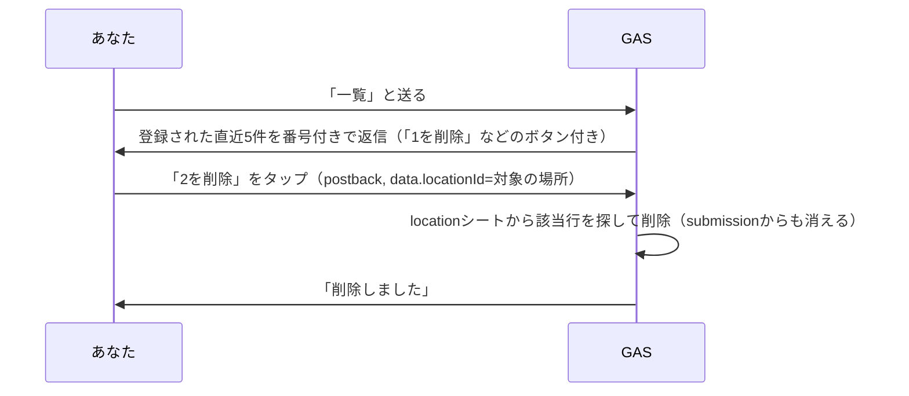

送りすぎた場所や、間違えて送った場所を**自分で見て、消せる**ようにします。state シートは使いません。`submission` シートを読んで、`location` シートの行を消すだけです。

## 全体の流れ



削除ボタンの `data` には、消したい場所の**場所ID（`locationId`）をそのまま**入れておきます。ボタンを見れば消す行が分かるので、「いまどの一覧を見せているか」を覚えておく必要がありません。state が要らないのはこのためです。

`submission` は数式でできたシートなので、直接は消せません。元になっている `location` シートの行を消すと、数式が組み直されて `submission` からも消えます。

## コードを書く

新しいファイル `一覧削除.gs` を作り、貼り付けます。

```javascript:一覧削除.gs
function replyLocationList(replyToken) {
  var locations = readSubmission().reverse().slice(0, 5);
  if (locations.length === 0) {
    replyText(replyToken, "まだ何も登録されていません。位置情報を送って登録してみてください。");
    return;
  }

  var lines = locations.map(function (loc, i) {
    return (i + 1) + ". " + loc.title + "\n" + loc.address;
  });
  var bodyText = "登録された場所（新しい順）\n\n" + lines.join("\n\n");

  replyTextWithQuickReply(replyToken, bodyText, buildDeleteQuickReply(locations));
}

function buildDeleteQuickReply(locations) {
  return {
    items: locations.map(function (loc, i) {
      return {
        type: "action",
        action: {
          type: "postback",
          label: (i + 1) + "を削除",
          data: JSON.stringify({ action: "delete", locationId: loc.locationId }),
          displayText: (i + 1) + "番目を削除"
        }
      };
    })
  };
}

function handleDeletePostback(replyToken, locationId) {
  var deleted = deleteLocationRow(locationId);
  if (deleted) {
    replyText(replyToken, "削除しました。");
  } else {
    replyText(replyToken, "その場所は見つかりませんでした（すでに削除済みかもしれません）。");
  }
  return deleted;
}

/**
 * location から場所IDが一致する行を消す。submission は数式なので、そこからも消える。
 * ハンズオン用の割り切りで、ほかの人の登録も消せる。
 */
function deleteLocationRow(locationId) {
  var sheet = getOrCreateSheet(SHEET_NAMES.LOCATION);
  var lastRow = sheet.getLastRow();
  if (lastRow < 2) return false;

  var values = sheet.getRange(2, 1, lastRow - 1, 7).getValues();
  for (var i = 0; i < values.length; i++) {
    if (values[i][2] === locationId) {
      sheet.deleteRow(i + 2);
      return true;
    }
  }
  return false;
}
```

`replyLocationList` は、Step2 で作った `readSubmission`（全問に答えた場所）を後ろから5件取り出します。シートの下にあるほど新しい登録なので、`reverse()` で新しい順にしています。

`deleteLocationRow` は、`location` シートから**場所ID が一致する行**を探して消します。消せたら `true`、見つからなければ `false` を返します。

:::message alert
**ほかの人が登録した場所も、一覧に出て、消せます。** `userId` で絞っていないからです。このハンズオンでは、1つのスプレッドシートを自分だけで使う前提の割り切りです。友だちにも使ってもらうときは、一覧を `location` の `userId` で絞る工夫が要ります（🎖️ に書いておきます）。
:::

## doPost から呼ぶ

`handleTextMessage` の最後にある、位置情報をお願いする返事の**すぐ上**に「一覧」を足します。

```diff:コード.gs
+  if (text === "一覧") {
+    replyLocationList(replyToken);
+    return;
+  }
+
   replyTextWithQuickReply(replyToken, "登録・検索したい場所の位置情報を送ってください", buildLocationQuickReply());
 }
```

`handlePostback` には、**先頭**に「delete」を足します。

```diff:コード.gs
 function handlePostback(replyToken, userId, messageId, data, displayText) {
+  if (data.action === "delete") {
+    if (handleDeletePostback(replyToken, data.locationId)) {
+      savePostback(userId, messageId, data.locationId, JSON.stringify(data), displayText);
+    }
+    return;
+  }
+
   var state = getState(userId);
```

先頭に置くのがポイントです。ほかのボタンは `state` を引いて「いま進んでいる会話のボタンか」を確かめますが、削除ボタンは会話と関係なく、いつでも押せます。state を探す前に処理を終わらせないと、「もう一度位置情報を送ってください」と返ってしまいます。

削除のボタンも、`postback` シートには**消せたときだけ**残します（`handleDeletePostback` が `true` を返したとき）。すでに消えた場所の古いボタンを押しても、`postback` に行は増えません。押した記録は `log` に残っています。

再デプロイして試します。

## ✅ 確認

1. 位置情報を送って登録を済ませ、「一覧」と送る（何か所か登録しておく）
   → 新しい順に最大5件と、「1を削除」などのボタンが返ってくる

   

2. どれかの削除ボタンを押す
   → 「削除しました」と返ってくる

   

3. もう一度「一覧」と送る

消した場所が一覧からも `location` シートからも、`submission` シートからも消えていれば成功です。

## 🎖️ 早く終わった人へ

### 🎖️ 件数を増やす

:::details 答えを見る
```diff:一覧削除.gs
-  var locations = readSubmission().reverse().slice(0, 5);
+  var locations = readSubmission().reverse().slice(0, 10);
```

クイックリプライのボタンは13個までなので、10件くらいまでが目安です。
:::

### 🎖️ 自分の登録だけを一覧に出す・消す

:::details 進め方のヒント
`submission` には `userId` の列がありません。`location` シートには `ユーザーID` の列があるので、`location` を読んで `userId` が同じ行だけを一覧に出し、`deleteLocationRow` にも `userId` の照合を足します。ただし `submission` を通らないので、全問に答えていない場所も出ます。`submission` に出ている場所IDと突き合わせると絞れます。
:::

### 🎖️ 削除の前に確認を挟む

:::details 進め方のヒント
いまは削除ボタンを押した瞬間に消えます。誤タップが気になるなら、`handleDeletePostback` でいったん「本当に削除しますか？」のボタンを返し、そのボタンの `data` に `action: "confirmDelete"` と `locationId` を入れておきます。`confirmDelete` が届いたら消す、という2段階にできます。ここでも state は要りません。
:::
