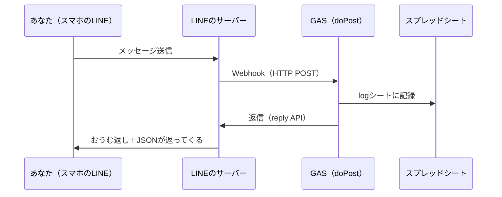

## はじめに

LINE Bot を作ろうとすると、まずサーバーをどうするかで手が止まりがちです。この記事では **Google スプレッドシート＋GAS（Google Apps Script）だけ**で、サーバーなしの LINE Bot を動かします。

- GAS 入りのスプレッドシートを用意したので、コピーするだけで始められます。コードは書きません
- 作るのはおうむ返し Bot ですが、**受け取ったメッセージの JSON も一緒に返します**。LINE から何が届いているのかがそのまま見えます
- 受け取ったイベントは、スプレッドシートの `log` シートにも残ります

最後に、なぜこれで動くのかを軽く解説します。

### 必要なもの

- Google アカウント
- LINE アカウント（スマホの LINE アプリ）

### 完成イメージ

Bot に「こんにちは」と送ると、2 通返ってきます。

1 通目は、送った言葉そのまま（おうむ返し）です。

```text
こんにちは
```

2 通目は、LINE から届いたメッセージの JSON です。

```json
{
  "type": "text",
  "id": "600000000000000000",
  "quoteToken": "xxxxxxxxxxxxxxxx",
  "text": "こんにちは"
}
```

スタンプや画像を送ったときは、おうむ返しはなしで JSON だけ返ってきます。

### 全体の流れ



## 1. スプレッドシートをコピーする

次のリンクを開くとコピーの確認画面が出るので、「コピーを作成」を押します。


https://docs.google.com/spreadsheets/d/1kfyI3yJstvT_v835bshojISIyL4ant2pt92-tyOO5m4/copy

コピーしたスプレッドシートで、メニューの「拡張機能」→「Apps Script」を開きます。


コードはもう入っています。中身はこれだけです。

```javascript:コード.gs
function doPost(e) {
  var body = JSON.parse(e.postData.contents);

  body.events.forEach(function (event) {
    saveLog(event);
    if (event.type === "message") {
      var messages = [];
      if (event.message.type === "text") {
        messages.push({ type: "text", text: event.message.text });
      }
      messages.push({ type: "text", text: JSON.stringify(event.message, null, 2) });
      reply(event.replyToken, messages);
    }
  });
  // LINE の Webhook 検証で 302 にならないよう、何も返さない
}

function reply(replyToken, messages) {
  callLineApi("https://api.line.me/v2/bot/message/reply", {
    replyToken: replyToken,
    messages: messages
  });
}

function callLineApi(url, payload) {
  var token = PropertiesService.getScriptProperties().getProperty("LINE_ACCESS_TOKEN");
  UrlFetchApp.fetch(url, {
    method: "post",
    contentType: "application/json",
    headers: { Authorization: "Bearer " + token },
    payload: JSON.stringify(payload)
  });
}

function saveLog(event) {
  var ss = SpreadsheetApp.getActiveSpreadsheet();
  var sheet = ss.getSheetByName("log");
  if (!sheet) {
    sheet = ss.insertSheet("log");
    sheet.appendRow(["記録日時", "ユーザーID", "イベント種別", "JSON"]);
    sheet.setFrozenRows(1);
  }
  var userId = event.source ? event.source.userId : "";
  sheet.appendRow([new Date(), userId, event.type, JSON.stringify(event)]);
}
```

ただ、この時点ではまだ動きません。LINE 側の準備（次の章）とトークンの設定（その次の章）が残っています。

## 2. LINE 公式アカウントを作る

Bot の器になる **LINE 公式アカウント**を作ります。

### アカウントを作成する

[LINE 公式アカウント作成フォーム](https://entry.line.biz/form/entry/unverified)を開き、LINE アカウントでログインします。アカウント名や業種を入れて作成します。アカウント名は友だちにも見えますが、あとから変えられます。

:::note info
LINE 側の画面や URL はちょくちょく変わります。この記事と違っていたら、公式ガイド「[Messaging API を始めよう](https://developers.line.biz/ja/docs/messaging-api/getting-started/)」を見てください。
:::


「完了」を押すと、アカウントが作成されます。


### 自動応答を OFF にする

このままだと LINE 公式アカウントの自動応答も返事をしてきて、Bot の返事と混ざります。

[LINE Official Account Manager](https://manager.line.biz/) の「設定」→「応答設定」で、**あいさつメッセージ**と**応答メッセージ**を OFF にします。


### Messaging API を有効にする

1. 左メニューの「Messaging API」を開く
2. 「Messaging APIを利用する」をクリック
3. 開発者情報（名前・メールアドレス）を登録し、プロバイダーを選ぶ（初めてなら新規作成）

:::note warn
プロバイダーはあとから変更・解除できません。名前は LINE ユーザーにも見えるので、本名や社名を出したくなければ別の名前にしておきましょう。
:::


### チャネルアクセストークンを発行する

Messaging API 画面の一番下にある「LINE Developers コンソール」のリンクから移動し、作成されたチャネルの「Messaging API設定」タブを開きます。一番下の**チャネルアクセストークン（長期）**で「発行」を押し、出てきた文字列をコピーしておきます。


:::note warn
チャネルアクセストークンは、Bot を好きに操作できるパスワードのようなものです。記事やスクショに写り込まないよう気をつけてください。
:::

## 3. GAS にトークンを設定してデプロイする

### スクリプトプロパティにトークンを登録する

トークンをコードに直接書くと、コードを人に見せたときに一緒に漏れてしまいます。なので GAS の**スクリプトプロパティ**に入れておきます。

Apps Script の左メニュー「プロジェクトの設定」（歯車）→「スクリプト プロパティ」→「スクリプト プロパティを追加」から、次の 1 つを登録して保存します。

| プロパティ | 値 |
| :--- | :--- |
| `LINE_ACCESS_TOKEN` | 前の章でコピーしたチャネルアクセストークン |


### ウェブアプリとしてデプロイする

1. 右上の「デプロイ」→「新しいデプロイ」


2. 歯車アイコンから「ウェブアプリ」を選ぶ


3. 次のように設定する

| 項目 | 設定値 |
| :--- | :--- |
| 次のユーザーとして実行 | 自分 |
| アクセスできるユーザー | **全員** |


4. 「デプロイ」を押し、アクセスの承認を求められたら許可する


途中で赤い警告（Google hasn't verified this app）が出ますが、これで正常です。作ったばかりのアプリは Google の審査を受けていないので、誰がやってもこの画面になります。左下の「Advanced」→「Go to（プロジェクト名）(unsafe)」で進みます。許可する相手は自分が持っているスクリプトです。


5. 表示された**ウェブアプリの URL**（`https://script.google.com/macros/s/.../exec`）をコピーする


:::note warn
「アクセスできるユーザー」が**全員**でないと、LINE のサーバーから届きません。
:::

## 4. Webhook を登録して動かす

1. LINE Developers の「Messaging API設定」タブを開く
2. 「Webhook URL」の「編集」に、コピーしたウェブアプリの URL を貼って「更新」
3. 「検証」を押す
4. 「Webhookの利用」を **ON** にする


「検証」で「成功」と出れば、LINE から GAS までつながっています。

### 動作確認

同じタブの QR コードをスマホの LINE で読み取って、Bot を友だち追加します。何か話しかけてみましょう。

- テキストなら「送った言葉」と「JSON」の 2 通、スタンプや画像なら JSON の 1 通が返ってくれば成功です
- スプレッドシートを見ると `log` シートができていて、話しかけるたびに 1 行ずつ増えていきます

## 5. 解説：なぜ動くのか

### Webhook と `doPost`

Bot に話しかけると、LINE のサーバーが登録しておいた URL に HTTP POST を送ってきます。これが Webhook です。GAS は `doPost` という名前の関数を置いておくだけで、ウェブアプリの URL に POST が届いたときに呼んでくれます。

```javascript
function doPost(e) {
  var body = JSON.parse(e.postData.contents);
```

`e.postData.contents` に、LINE から届いた JSON の文字列が入っています。

### `events` は配列

```javascript
body.events.forEach(function (event) {
```

LINE から届く JSON の `events` は配列で、1 回の Webhook に複数のイベントが入ってくる場合もあります。なので `forEach` で回しています。テキストもスタンプも友だち追加も、全部 `events` の 1 要素として届くので、`event.type` で見分けます。

### 返信は `replyToken` で行う

```javascript
var messages = [];
if (event.message.type === "text") {
  messages.push({ type: "text", text: event.message.text });
}
messages.push({ type: "text", text: JSON.stringify(event.message, null, 2) });
reply(event.replyToken, messages);
```

イベントには `replyToken` が付いてきます。これをそのまま reply API に渡すと、そのメッセージへの返信になります。返信の中身は `messages` 配列で、1 回に 5 通まで入れられます。ここではテキストのときだけ 1 通目に「送った言葉」を入れ、そのあとに `JSON.stringify(event.message, null, 2)`（整形した JSON）を足しています。

:::note warn
`replyToken` が使えるのは **1 回だけ・約 1 分以内**です。同じトークンで 2 回返信するとエラーになるので、複数送りたいときは `messages` にまとめて 1 回で送ります。
:::

### トークンは Authorization ヘッダーで渡す

```javascript
headers: { Authorization: "Bearer " + token },
```

チャネルアクセストークンは `Bearer` を付けてヘッダーで渡します。LINE はこれを見て、どの Bot からの返信なのかを判断しています。

### ログを先に残す

```javascript
saveLog(event);
if (event.type === "message") { ... }
```

返信より先に記録しているので、返信でエラーになっても「受け取った」ことは `log` シートに残ります。動かないときに、どこまで届いているかを見るのに便利です。

### なぜコピーしただけで動くのか

`SpreadsheetApp.getActiveSpreadsheet()` は、そのスクリプトが紐づいているスプレッドシートを指します。シートをコピーするとスクリプトも一緒についてくるので、スプレッドシートの ID を書き換えなくて済みます。テンプレートにはトークンを入れていないので、トークンだけは自分で登録します。

## つまずきポイント

### Webhook の「検証」が失敗する

- URL の末尾が `/exec` になっているか（`/dev` ではない）
- デプロイ設定の「アクセスできるユーザー」が**全員**になっているか

### Webhook の「検証」がタイムアウトする

「Webhookイベントオブジェクト送信時にタイムアウトが発生しました」と出る場合です。GAS は久しぶりに呼ばれると起動に時間がかかるので、初回だけ LINE 側の待ち時間を超えてしまいます。もう一度「検証」を押すと、だいたい通ります。

### コードを変えたのに反映されない

GAS は保存しただけでは LINE 側に反映されません。「デプロイ」→「デプロイを管理」→ ✏️（編集）→ バージョンを「新バージョン」にして「デプロイ」します。この方法なら URL は変わりません。

:::note warn
「新しいデプロイ」をもう一度実行すると URL が変わってしまいます。その場合は Webhook URL も登録し直してください。
:::

なお、スクリプトプロパティの値を変えただけなら、再デプロイは不要です。

### メッセージを送っても何も返ってこない

- 「応答メッセージ」「あいさつメッセージ」が OFF になっているか
- 「Webhookの利用」が ON になっているか
- スクリプトプロパティの `LINE_ACCESS_TOKEN` が、この Bot のチャネルのトークンか
- `log` シートに行が増えているか（増えていれば GAS までは届いています。増えていなければ Webhook 側を疑います）
- Apps Script の左メニュー「実行数」に `doPost` の実行が並んでいるか（並んでいれば GAS まで届いています）


## 次にやること

ここまで来たら、あとは返事の中身を変えて遊べます。たとえば、送られた言葉によって返事を変えてみます。`doPost` の `if` の中を次のように書き換えて、再デプロイしてみてください。

```javascript:コード.gs
    if (event.type === "message") {
      var messages = [];
      if (event.message.type === "text" && event.message.text.includes("おなかすいた")) {
        messages.push({ type: "text", text: "近くのお店を探しましょう🍜" });
      } else {
        if (event.message.type === "text") {
          messages.push({ type: "text", text: event.message.text });
        }
        messages.push({ type: "text", text: JSON.stringify(event.message, null, 2) });
      }
      reply(event.replyToken, messages);
    }
```

位置情報やスタンプを送って、届く JSON を見比べるのも面白いです。`event.message.type` が `location` や `sticker` に変わり、位置情報なら緯度経度も入ってきます。

## 参考

- [Messaging API を始めよう（公式ガイド）](https://developers.line.biz/ja/docs/messaging-api/getting-started/)
- [LINE 公式アカウント作成フォーム](https://entry.line.biz/form/entry/unverified)
- [Messaging API リファレンス](https://developers.line.biz/ja/reference/messaging-api/)
- [Webhook の仕組み](https://developers.line.biz/ja/docs/messaging-api/receiving-messages/)
- [Apps Script ウェブアプリ](https://developers.google.com/apps-script/guides/web)
